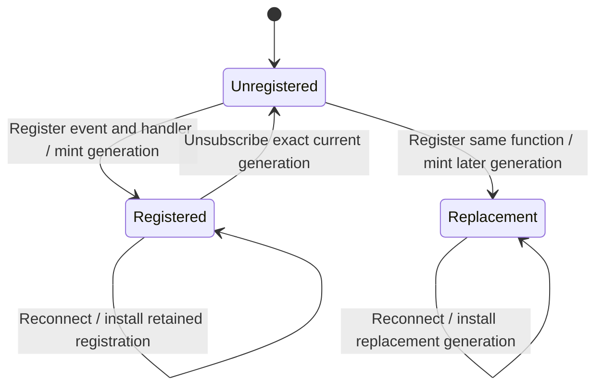

One event-handler pair with two registration generations; a stale unsubscribe cannot remove its replacement, and reconnect installs only the retained generation.

Transport callback reentrancy and independent event/handler identities require TypeScript tests; shared handles refer to one registration rather than independent reference counts.

## Model coverage

Direct finite safety model. One event-handler pair with two registration generations; a stale unsubscribe cannot remove its replacement, and reconnect installs only the retained generation.

Transport callback reentrancy and independent event/handler identities require TypeScript tests; shared handles refer to one registration rather than independent reference counts. Terminal states may stutter. This scoped review at `77a6b620af4d94b234294f6d273fd74b3dfb44c7` does not claim implementation proof or an executed source test.
