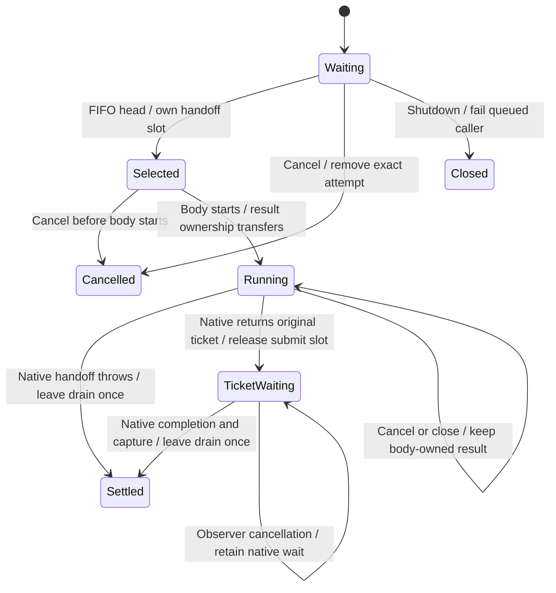

# Queue a native product submission

A second product request waits behind the native handoff already underway. The FIFO lane releases when that handoff returns a ticket or throws; it does not wait for the ticket response. Ready, events and session calls retain their separate try-once Busy rules. Product submissions have no Swift Busy path.

The worker enters its drain group before awaiting the lane. A queued cancellation removes that exact attempt and releases its caller without waiting for the active body. Cancellation before a selected body starts also prevents it from running. Once the body starts, it owns its result even if cancellation or shutdown follows. A native error releases the drain admission on the no-ticket path. A returned ticket transfers that admission to a concurrent ticket wait, which leaves once after capture succeeds or throws. A capture exception retains the actual native completion inside NativeProductCaptureFailure.

Close first wakes native I/O, then fails queued attempts with Closed and prevents new admissions. A selected or running handoff keeps its own result; it is not turned into a queued Closed refusal. The drain waits for admitted handoffs and ticket captures. Close and Swift observer cancellation do not prove that a submitted gateway command did nothing. Native timeout, capacity, method/JSON refusal and wire correlation remain [product command](commands.md) decisions. The native request deadline is created only when handoff reaches Rust ProductSession.request; it does not include time in the Swift queue. A Swift queue wait has no timeout or configured capacity bound.

The model bounds three attempts solely to explore FIFO, middle cancellation, separate ticket waits and shutdown. It does not claim a product queue bound, scheduler fairness, eventual response or physical network cleanup. Core ticket outcome details are parameters rather than a second implementation of core protocol decisions.

## Source and executed evidence

The bounded narrative was reconciled to main source `719dfce93892e09dcb95e86a060b6d2f42c8f3cc`. The actual production Swift lane and worker were compiled with Swift 6 complete concurrency checking and warnings as errors. The lane probe uses a concurrent dispatch queue, holds a body, admits eight waiters, cancels a middle waiter, exercises body failure, closes with queued callers and cancels after close during a started body. Both focused Swift executables passed. The worker probe uses stand-in generated session types to check throwing capture with one and three outstanding requests and retained ticket/drain ownership after closing and cancelling an active native handoff. Native UniFFI, live gateway, iOS vendor package, simulator and physical-phone execution are excluded.

## Bounded rule model

Three fixed arrival identities explore FIFO handoff, exact waiting/selected cancellation, body refusal, ticket transfer, capture and close. Native ticket timeout/disconnect are terminal completion parameters at CaptureCompletion; a capture exception still retains that completion and leaves the drain once. An already running body remains eligible to return its ticket after close. Ticket waits do not retain the submit slot. This is a finite safety abstraction, not the configured Swift queue length or a liveness guarantee. The model checks design safety, not the implementation. It asserts no liveness and abstracts transport timing into nondeterministic completion order. Regression sources are evidence of intended behavior; this documentation change does not claim their execution.

## Model coverage

Disposition: direct model. The bounded model covers the exact owner and event ordering described here; the finite analysis bound is not a product capacity or liveness promise.
