# Queue a native product submission

When two callers submit requests at once, the Swift worker passes them to the
native client one at a time, in arrival order. Each short **handoff** returns a
**ticket**, an identity used to wait for that request's reply. Waiting for the
reply does not block the next handoff.

For example, a second request can be cancelled while the first is being handed
over. If the second request has not started its handoff, its body will not run.
Once a handoff starts, cancellation cannot establish that the gateway did nothing.

## Cancellation and orderly close

This page describes closing the native worker while its process and queues can
still run. It does not establish what happens on app quit, suspension, a crash or
an OS kill, or promise that results survive a restart.

| Where the request is                   | What cancellation or close means                                                                                                                                              |
| -------------------------------------- | ----------------------------------------------------------------------------------------------------------------------------------------------------------------------------- |
| Waiting in the queue                   | Cancellation removes that exact attempt. Close refuses queued work and new admissions with `Closed`.                                                                          |
| Selected, but its body has not started | Close alone leaves the selected attempt alone. Cancellation can still prevent it from running; it reports cancellation while open, or `Closed` if the lane is already closed. |
| Handoff body has started               | The body keeps its result even after cancellation or close. It may throw or return its original ticket.                                                                       |
| Waiting for a ticket reply             | Waiting remains separate from the queue. Cancelling the Swift observer does not prove the submitted command was cancelled.                                                    |

The worker counts admitted work so orderly shutdown can wait for it. This count
is the **drain group**. A handoff that throws releases its place in that group.
A returned ticket transfers the place to the reply wait, which releases it once
after converting the reply to a caller-owned value. That conversion is called
**capture**. If capture throws, `NativeProductCaptureFailure` retains the actual
native completion.

```mermaid
stateDiagram-v2
 [*] --> Waiting
 Waiting --> Selected: First in queue
 Waiting --> Cancelled: Cancel while open
 Waiting --> Closed: Close or cancel after close
 Selected --> Cancelled: Cancel before body starts while open
 Selected --> Closed: Cancel before body starts after close
 Selected --> Running: Body starts and owns its result
 Running --> Settled: Handoff throws
 Running --> TicketWaiting: Ticket returned; next handoff may start
 TicketWaiting --> Settled: Completion captured or capture fails
 Running --> Running: Cancel or close; retain body result
 TicketWaiting --> TicketWaiting: Observer cancels; native wait continues
```

## Queue limits and other operations

The Swift queue has no configured capacity or waiting timeout. The Rust request
deadline starts only when the handoff reaches `ProductSession.request`; time
waiting in Swift is excluded. Native capacity, timeout, invalid method/JSON and
reply identity remain [product command](commands.md) decisions.

Product submissions wait rather than returning Swift `Busy` immediately. Ready,
event and session calls still have separate try-once rules that can return Busy.
The model uses three attempts to explore ordering and cancellation. Three is an
analysis bound, not a limit enforced by the Swift queue.

## Source and executed evidence

The bounded narrative was reconciled to main source `719dfce93892e09dcb95e86a060b6d2f42c8f3cc`. The actual production Swift lane and worker were compiled with Swift 6 complete concurrency checking and warnings as errors. The lane probe uses a concurrent dispatch queue, holds a body, admits eight waiters, cancels a middle waiter, exercises body failure, closes with queued callers and cancels after close during a started body. Both focused Swift executables passed. The worker probe uses stand-in generated session types to check throwing capture with one and three outstanding requests and retained ticket/drain ownership after closing and cancelling an active native handoff. Native UniFFI, live gateway, iOS vendor package, simulator and physical-phone execution are excluded.

## Bounded rule model

Three fixed arrival identities explore FIFO handoff, exact waiting/selected cancellation, body refusal, ticket transfer, capture and close. Native ticket timeout/disconnect are terminal completion parameters at CaptureCompletion; a capture exception still retains that completion and leaves the drain once. An already running body remains eligible to return its ticket after close. Ticket waits do not retain the submit slot. This is a finite safety abstraction, not the configured Swift queue length or a liveness guarantee. The model checks design safety, not the implementation. It asserts no liveness and abstracts transport timing into nondeterministic completion order. The two focused Swift probes described above ran in the recorded verification
pass. Rust product suites, real UniFFI integration and phone/live-gateway tests
were not run in that pass. This prose correction does not rerun those probes or
TLC, or extend their recorded scope.

## Model coverage

Disposition: direct model. The bounded model covers the exact owner and event ordering described here; the finite analysis bound is not a product capacity or liveness promise.
