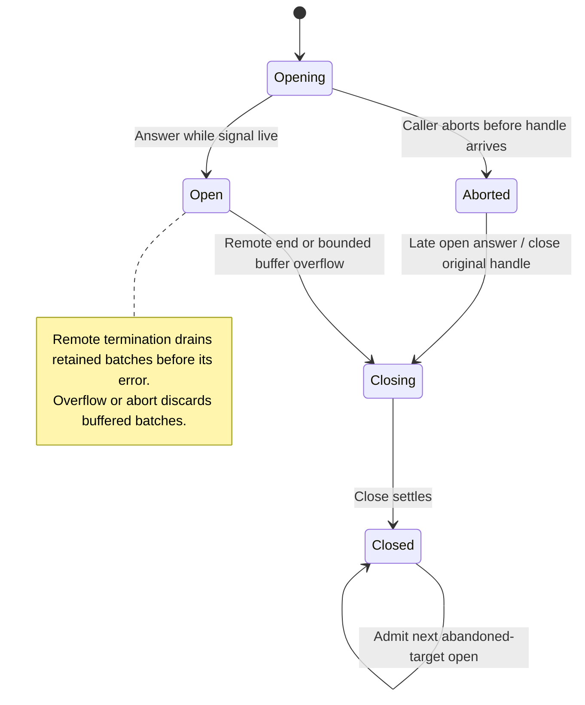

One target open whose answer can race abort, next same-target admission after abandoned-open cleanup, and a two-batch single-consumer buffer with remote end or overflow.

Remote-end buffers drain before the error, whereas abort/overflow discard. Cursor/schema validation, event-source loss and actual gateway unsubscribe are external contracts; the bound stands for the configured buffer size.

## Model coverage

Direct finite safety model. One target open whose answer can race abort, next same-target admission after abandoned-open cleanup, and a two-batch single-consumer buffer with remote end or overflow.

Remote-end buffers drain before the error, whereas abort/overflow discard. Cursor/schema validation, event-source loss and actual gateway unsubscribe are external contracts; the bound stands for the configured buffer size. Terminal states may stutter. This scoped review at `77a6b620af4d94b234294f6d273fd74b3dfb44c7` does not claim implementation proof or an executed source test.
