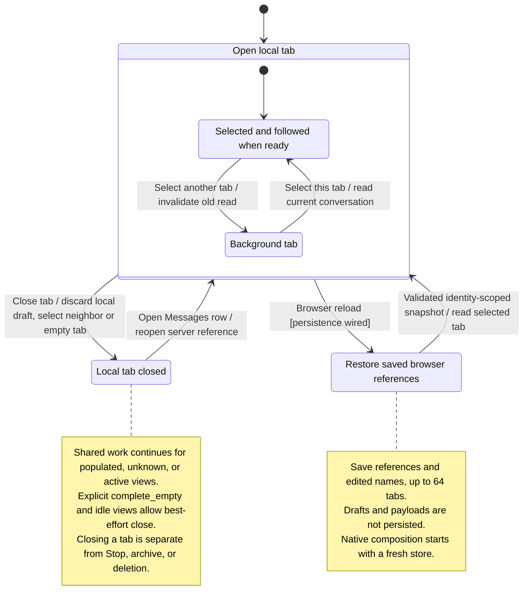

# close, switch, reopen, and restore tabs

Each tab keeps its own draft and selected conversation. Switching tabs shows that tab's content. Closing a tab usually removes the view while the conversation and agent work remain available.

The browser can restore a limited list of conversation IDs and local titles after reload, but it does not restore unsent drafts. A native window starts with fresh local tabs. Closing the last tab opens a replacement draft. Automatic remote cleanup requires a proven-empty idle conversation with no pending work; an ordinary prepared conversation does not automatically meet that condition.

## Further reading

[Source](../../../../../src/panel/application/tab-navigation.ts) · [Related source](../../../../../src/conversation/application/usecases/close-conversation.ts) · [Related tests](../../../../../crates/nessa-server/tests/conversation/projection.rs)

## Bounded rule model

One remote conversation is restored under up to three fresh local lifetimes. Retired callbacks cannot name the replacement. This intentionally excludes multi-tab close-neighbor selection, bounded storage parsing, owner/gateway namespace validation and backend history persistence; source tests own those contracts. The model checks design safety, not the implementation. It asserts no liveness and abstracts transport timing into nondeterministic completion order. Regression sources are evidence of intended behavior; this documentation change does not claim their execution.

## Model coverage

Disposition: direct model. The bounded rule model section names the modeled owner slice and finite abstraction.

Excluded: All exclusions stated in the owning Bounded rule model section remain outside verification.

Source review scope: owner entry points and relevant regression declarations were inventoried against frozen source `77a6b620af4d94b234294f6d273fd74b3dfb44c7`. Existing source checkpoints are retained where this was a partial review. A model result establishes bounded design safety only. Browser appearance and interaction were not checked.
