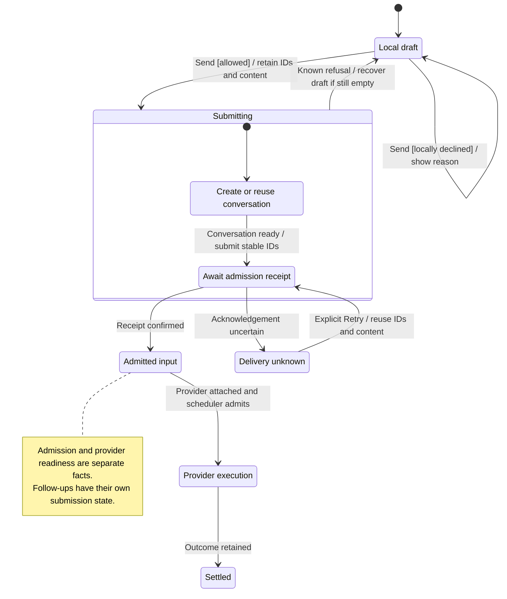
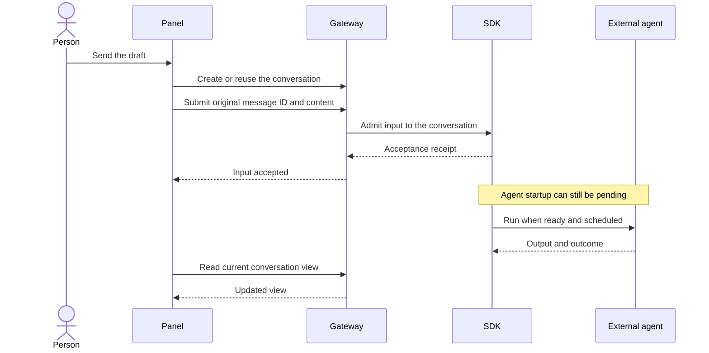
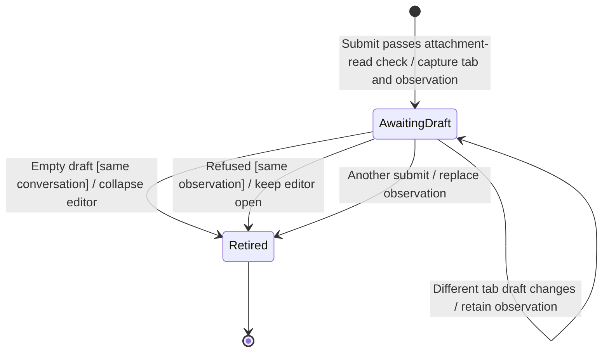

# compose and send the first message

Open a new conversation, choose a model and write a message. Enter sends it; Shift+Enter starts a Markdown block. Text can be empty when there are sendable attachments. The voice button has no working voice action yet.

Send keeps the original message identity and content while it waits for acceptance. Acceptance means Nessa owns the input. The external agent may still be starting. Pending or failed uploads, unsupported attachments and oversized text prevent sending. The panel binds its initial model choice when it creates the remote conversation. The desktop workspace also supports [staging a model change before the next send](../../sdk/runtime/select-a-model-approval-preset-or-reasoning-effort.md); that control does not imply a second conversation.

## Who handles the send

## Further reading

[Source](../../../../../src/panel/ui/use-composer.ts) · [Related source](../../../../../src/conversation/ui/use-conversation.ts) · [Related tests](../../../../../src/panel/ui/use-composer.test.ts)

## Composer ownership while a send waits

The expanded editor closes when its own submitted draft leaves. Switching tabs gives the selected tab a fresh collapsed editor; subsequently expanding that tab is a new local choice. A pending send from another tab must not collapse it when its draft is cleared.

Submission callbacks also carry operation identity. An old refusal clears only its own pending observation, so it cannot prevent a newer accepted send from closing its editor. The correction is local presentation; the conversation store remains the admission and prepared-command owner.

This small chart follows one pending observation, rather than the transport or the expanded editor itself. A replacement observation has a new identity. A promise callback for an older one cannot clear that replacement.

The [CO1–CO4 design table](../../../../design/user-flow-ordering.md#composer-draft-observation) owns these orderings. The [hook regressions](../../../../../src/panel/ui/use-composer-ordering.test.tsx) exercise the actual hook through a form with controlled submission promises; they do not establish provider completion.

This is a bounded correction to the composer owner. The other linked source files have no implementation changes since the earlier checkpoint. The checkpoint advances to the committed correction after reconciling that hook and its regression tests; the other source owners retain their unchanged implementation.
