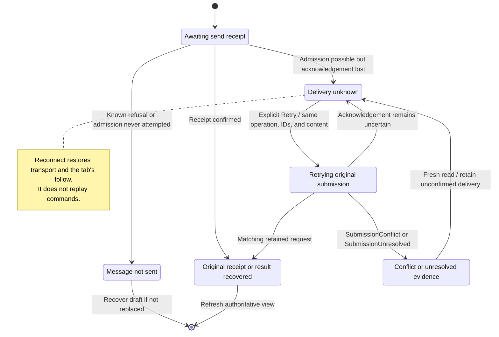
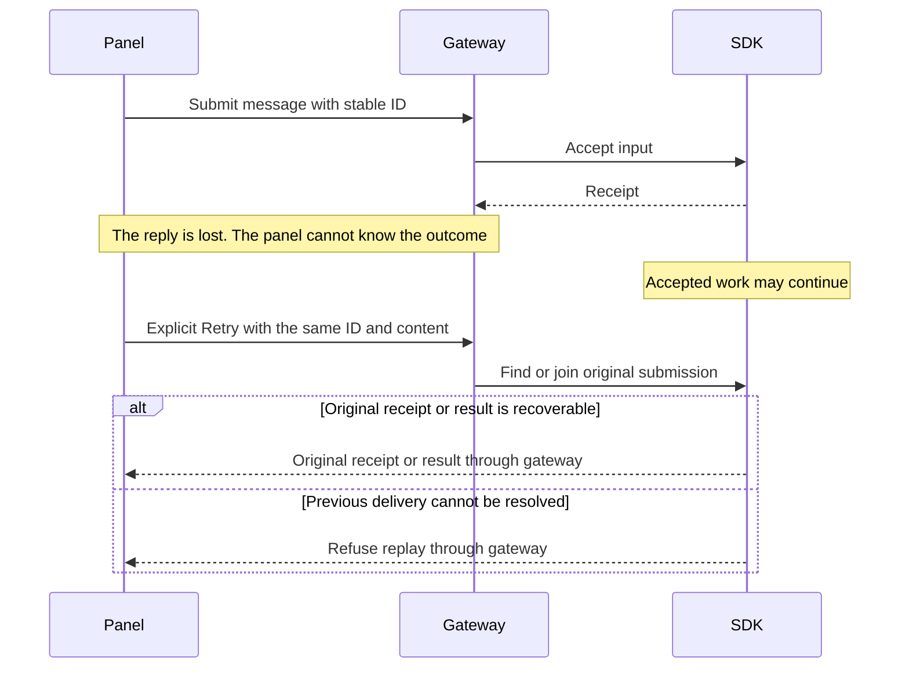

# recover a refused or unconfirmed send

A known refusal means the send was not accepted. Nessa can restore the unsent draft if doing so would not overwrite a newer draft.

A missing reply means the outcome is unknown. The original message may already be running. Explicit Retry uses its original IDs and content to recover the same submission. Reconnecting alone never resends it. Changing the content is a new action, not recovery of the old one.

## Several refused messages

Each refused message keeps its own error and diagnostic. The conversation's
error belongs to whichever failure happened last, and one notice slot shows
one failure at a time. A refused message is never lost from the slot: once
nothing newer holds it, the latest refused message is offered again. Whether
the conversation's error is a refused message's own is recorded with it, as
the turn that set it, and never read from the text: a control can fail in the
same words.

| # | State | Event | Notice shows | Conversation error |
|---|-------|-------|--------------|--------------------|
| 1 | One refused message | none | Error sending for it | its error |
| 2 | Two refused messages | Send Again on the newer, accepted or still sending | Error sending for the older, with its own error; Send Again puts it back in the empty draft (files to upload again) and sends it | cleared |
| 3 | Two refused messages | Send Again on the newer, refused again | Error sending for the newer | the newer's new error |
| 4 | A refused message | a control (Close, an answer) fails afterwards | the control failure | the control's error |
| 5 | A refused message and a later control failure | Discard the refused message | the control failure | unchanged |
| 6 | Two refused messages, the newer's error current | Discard the newer | Error sending for the older | the older's error |
| 7 | A refused message | a control fails afterwards in the same words | the control failure | the control's error |
| 8 | Two refused messages, the older pointing at a file by path | Send Again on the newer, accepted; then Send Again on the older | the older is sent at once, since a file sent by path has nothing to upload | cleared |

Tests: rows 1 to 4 and 7 in `src/conversation/ui/notification.test.ts`; rows
4 to 7 through the store in `src/conversation/adapters/store/unsent.test.ts`;
rows 2 and 8's Send Again through the rendered control in
`src/conversation/ui/conversation-notification.test.ts`, its attachments in
`src/conversation/application/usecases/attachments.test.ts`, and in a real
browser with `verification/desktop/scripts/refused-messages.mjs`.

## Recovering a lost reply

## Further reading

[Source](../../../../../src/conversation/adapters/store/slice.ts) · [Related source](../../../../../src/conversation/application/usecases/send-draft.ts) · [Related tests](../../../../../src/conversation/adapters/store/unsent.test.ts)
