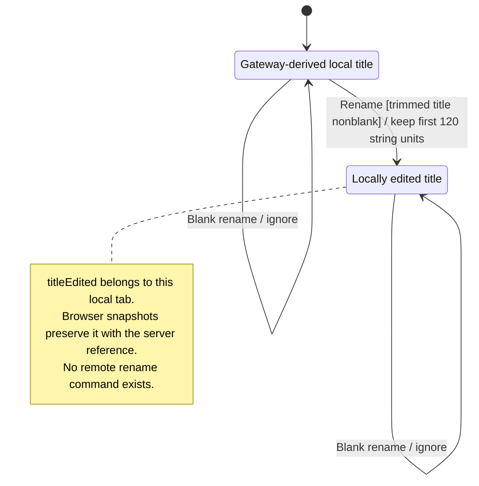

# rename a tab and inspect conversation details

Renaming changes the tab title in this window. It does not rename the server conversation or change the agent's stored context. Blank names are ignored.

Another surface may still show the gateway title. Local titles are limited to 120 JavaScript string units, so an emoji at the boundary may be split. That is a documented concern requiring a rendering check, not a reproduced failure here.

## Further reading

[Source](../../../../../src/panel/ui/app.tsx) · [Related source](../../../../../src/conversation/ui/conversation-details.tsx) · [Related tests](../../../../../src/conversation/ui/conversation-details.test.tsx)

## Model coverage

Disposition: direct model. The bounded rule model section names this owner, its guarded transitions and the finite design checked. Pure value parsing and geometry stay with the linked source contracts. No claim is made that a checked design is an implementation proof.

The source owner and regression intent were traced at `77a6b620af4d94b234294f6d273fd74b3dfb44c7`; older page checkpoints are retained where the wider journey was only partially re-reviewed. No browser or application-test execution is claimed.

## Bounded rule model

Two local tab identities distinguish locally edited names from gateway titles. Renaming targets its exact tab and marks the title as user-owned; later source projection cannot overwrite that choice. Empty trimmed names are refused. The 120-character bound and detail-sheet fields are immutable projection/format contracts. Details show source evidence and do not authorize a tool or restart an agent. Tab restoration has its own identity model. The model checks design safety, not the implementation. It asserts no liveness and abstracts transport timing into nondeterministic completion order. Regression sources are evidence of intended behavior; this documentation change does not claim their execution.
