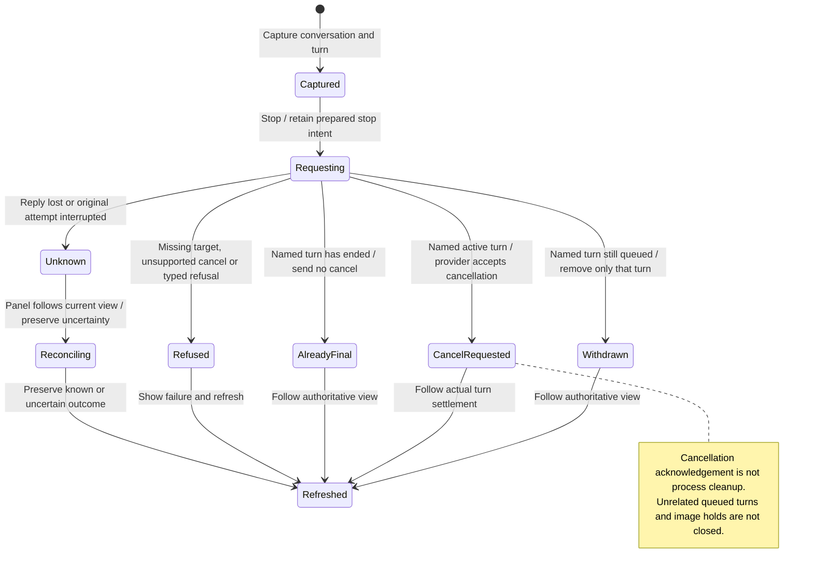

# stop active and queued work

Stop targets the captured turn: withdraw it from the queue or cancel it if active. Unrelated queued turns and the agent attachment remain available.

The panel captures the running turn, or its latest unsettled submission, together with its conversation identity. A delayed Stop cannot target a different conversation after tab rebinding. Stop can overtake a pending send; the prepared operation remembers it and asks again after admission. Closing the attachment, deleting a conversation and detaching a tab are separate operations. Stop does not release uploaded images or prove external tool effects were reversed.

The [mutation command regressions](../../../../../crates/nessa-server/tests/conversation/mutation_commands.rs) cover queue-to-active races, a concurrent close, unsupported cancellation, finished turns and receipt recovery. They distinguish the durable Stop command from the eventual turn outcome. The panel refreshes the current view after failure; it does not automatically look up or replay a Stop receipt. Explicit command clients can read the original receipt with its exact binding.

## Owned descendants

Stopping an active parent also captures unfinished owned child and grandchild
turns by default. The gateway selects exact execution identities through the
existing ownership coordinator. It withdraws captured report-created parent
inputs before cancelling the parent, then stops the selected descendants.
Unrelated conversations are outside that selection. The namespace setting
`subagents.stopChildrenOnParentStop: false` selects parent-only scope; it does
not close the descendant lifetimes or change their permissions.

The [parent Stop browser check](../../../../../verification/desktop/scripts/parent-stop.mjs)
drives the window Stop button and the explicit override. The
[recovery regressions](../../../../../crates/nessa-server/tests/conversation/parent_stop/confirmed_recovery.rs)
retain the original confirmed Stop actor after process loss and distinguish
unconfirmed receipts. These are separate from the unresolved historical default
stress run in which parent and descendants stayed active; a later passing
reproduction does not establish that failure's cause.

This page's source checkpoint covers the panel's captured target, the gateway's
selection/order, the configuration default and the cited regression contracts at
that revision. It is not a fresh admission-lock review, a process-cleanup proof,
or executed browser/platform evidence for the integrated tree. Other state
pages retain their own checkpoints.

## Further reading

[Source](../../../../../src/panel/ui/app.tsx) · [Related source](../../../../../src/conversation/adapters/store/slice.ts) · [Related tests](../../../../../src/conversation/adapters/store/control-failure.test.ts)
