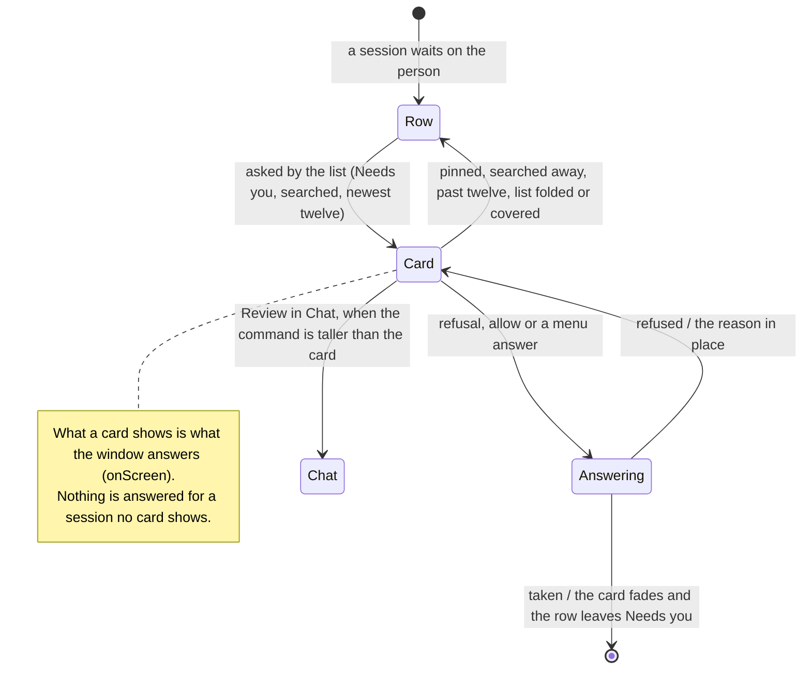

# answer requests from the session list

In three columns, the session list leads with the channel's pinned sessions,
then groups the rest Needs you, Running and Earlier. Each row in Needs you that
the list asks about — as its search lists it, the newest twelve
(`listAskIds`) — is a request card: who asks, the command as the transcript
card reads it, and the review's refusal and primary allow, every other answer
in the menu beside them. Those sessions are on screen: the window reads and
keeps their conversations, and answers what their cards show. A pinned
session, a row the search hides, a row past the twelve, or any row while the
list is folded or under the Agents overview, asks nothing from the list.

## Further reading

[Source](../../../../../src/desktop/workspace/ui/session-list/list-request.tsx) · [Related source](../../../../../src/desktop/workspace/application/workspace-state.ts) · [Related tests](../../../../../src/desktop/workspace/ui/session-list/list-request.test.tsx)
