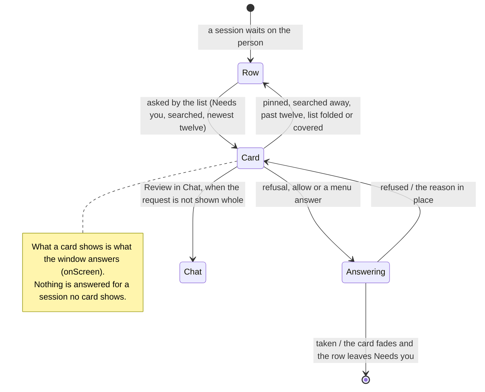

# answer requests from the session list

In three columns, the session list leads with the channel's pinned sessions,
then groups the rest Needs you, Running and Earlier. Each row in Needs you that
the list asks about — as its search lists it, the newest twelve
(`listAskIds`) — is a request card: who asks, the command as the transcript
card reads it, and the review's refusal and primary allow, every other answer
in the menu beside them. Those sessions are on screen: the window reads and
keeps their conversations, and answers what their cards show. A pinned
session, a row the search hides, a row past the twelve, or any row while the
list is folded or under the Agents overview, asks nothing from the list.

A card allows only a request it can only draw whole, decided from the
request itself and never from how it laid out (`allowableFromList`): a
command, as the card reads it, and every name the card shows (the agent's
tool, or the app and its tool) in printable ASCII, so no character is wider
than a column, joins another or reorders the line; nothing in the tool's
input but the command; and names of at most 48 characters. The command also
keeps to three lines at the list's narrowest width (21 columns), which holds
the card small; a whole card is never cut in height, so the count only
sizes it. Such a request is drawn in full
with its answers. Any other request is a preview with its refusals and
Review in Chat, which opens the conversation, where the transcript card
shows it whole.

## Further reading

[Source](../../../../../src/desktop/workspace/ui/session-list/list-request.tsx) · [Related source](../../../../../src/desktop/workspace/application/workspace-state.ts) · [Related tests](../../../../../src/desktop/workspace/ui/session-list/list-request.test.tsx)
