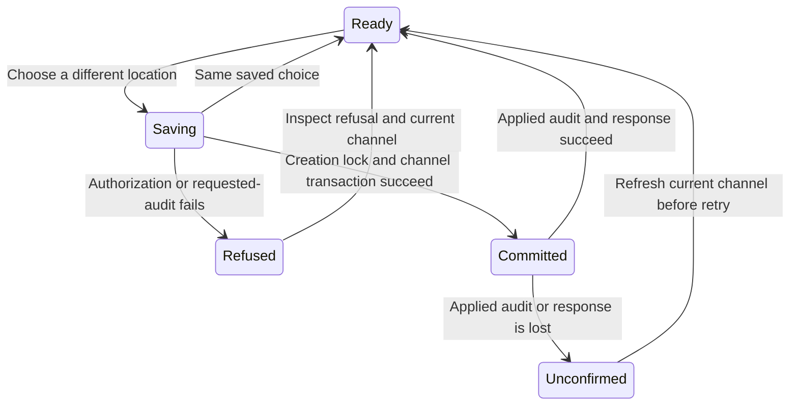

# Change a channel’s run location

Open the channel's settings and change **Main agent runs on** or **New threads run on**. Main placement is local or Boat; new threads may also use Any computer. Boat is offered in the UI only while its connection reports connected. The gateway owns authorization and actual environment admission; the control is not proof that a future allocation will succeed.

Changing future-thread placement leaves existing threads where they started. Changing main placement gives an already begun main conversation a new successor identity; the old conversation remains a thread with its history and location. If the main conversation has never begun or been linked into the channel, the store keeps its identity and the later creation uses the new location. The UI's short “fresh main chat” description must be read with that distinction.

## Creation and movement share an owner

The application authorizes channel settings, reads the main identity, takes that identity's creation lock and rereads the channel. If the main identity changed meanwhile, it retries with the new lock. This prevents the move from slipping between main creation's placement read and its saved placement. The store transaction changes coordinator/thread placement together; when a begun main moves, it also journals its successor in that transaction. Thread-only changes do not replace the main.

The default channel has no stored channel settings to move. Another person's channel does not become editable through a guessed ID. The source tests exercise owner admission and the unchanged-choice fast path.

## Failure can follow a committed move

Before the transaction, the application writes a settings-audit request containing channel, old/new placement, main identity and caller. Failure here prevents the move. After the transaction, it records applied evidence including the resulting main identity. Failure at this second audit step returns unavailable even though placement has changed.

The window holds both selectors while its request is pending and displays a failure after refusal. It does not prove rollback or automatically repair missing audit evidence. Refresh the channel before choosing again. Repeating an already saved placement returns the current channel without making another successor; a later conflicting choice is a new change, not replay of a durable request receipt. Do not infer exactly-once movement from the transport request ID.

Closing settings does not move old conversations back. These controls do not copy workspace files, terminate old threads, allocate a replacement VM immediately, or establish that a provider can resume. [Channel workspaces](../../gateway/channel-workspaces.md) owns the allocation and retained workspace boundaries; [pool order](choose-worker-pool-order.md) owns Any computer selection.

## Implementation evidence

[Channel application tests](../../../../../crates/nessa-conversation/tests/conversation/channels.rs) include `only_the_owner_moves_a_made_channel_and_an_unchanged_one_stays_as_it_is` and `a_move_that_cannot_be_recorded_is_refused_and_changes_nothing`. [SQLite channel tests](../../../../../crates/nessa-conversation/tests/conversation/channel_store.rs) cover replacement identity and preserved memberships. [Rendered controls](../../../../../src/desktop/workspace/ui/channel-settings/channel-settings.test.tsx) cover Boat availability, holding both rows during a save and typed refusal copy.

## Verification scope

This task guide was source-reviewed at `31d023ed3e4cd60053f771d44137f6af1e1b92ca`. It has no TLA model: the existing device-polling, permission-rule and Boat-allocation models do not verify this new feature. Regression links identify relevant implementation tests; execution results and independent review are recorded in [the refresh evidence](../../../feature-refresh-1268.md). No full application, real cloud or cross-platform qualification is claimed.
