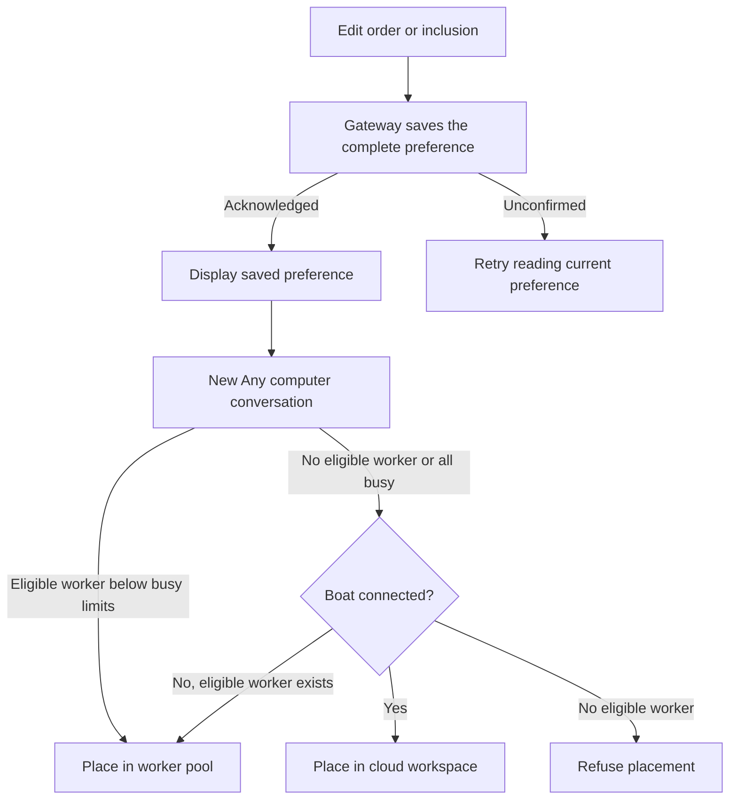

# Choose where new threads run

Open Devices to edit the gateway's default order. In a channel's settings, choose the default or a separate order for that channel. Move computers up/down and include or leave them out; each change saves immediately. The channel's order and exclusions replace the default together. They are not merged. This controls **Any computer** threads, not a live migration of every conversation.

Here, a lease is the gateway’s temporary ownership of an opened agent on a worker; a binding is its saved worker choice. Provider context is the native provider session history available on that worker, not a copy of workspace files.

For example, put worker A before B. A receives a newly chosen lease while eligible and below the busy limits even if B has fewer leases. If A is busy, B is preferred. With every eligible worker busy, a *new conversation* can be placed on Boat when connected; an existing pool conversation instead keeps or chooses a pool binding. These are separate decisions.

## What the gateway chooses

The placement owner filters to serving workers that are not draining, avoided or excluded. It prefers non-busy workers by configured rank, then agent-lease count, then key. If all eligible workers are busy, lease selection uses the same ordering among them. An absent machine-use report is not busy. Unnamed computers remain eligible after explicitly ordered ones; this Mac is not implicitly a paired worker.

At the next lease opening, an existing binding stays on its worker while eligible even if busy. Exclusion, draining, departure or an avoidance request can force another binding, whose provider context starts empty. The binding is saved before asking for the lease. Editing an order alone does not transfer an active lease or move provider history between computers.

A preference permits at most 64 entries in each list and refuses duplicate or overlapping names. The UI retains configured computers absent from the displayed list when saving, subject to that bound. Display names are not durable identities; equal hostnames receive a key suffix.

## Recover an unconfirmed save

The editor discards old read/save answers after its request generation retires. An unconfirmed save removes its displayed preference and offers a read retry; read current state before editing again. Leaving the page does not undo an accepted save. The gateway retains the configuration lock through publication and audit even after caller loss.

The settings adapter records the requested scope, previous/requested values and caller before touching config.json. It then records unchanged, durable, not-durable or failed publication. A durable write followed by an audit-write failure still returns unavailable. Thus an error is not evidence that the old preference remains. A reread establishes configuration state, not completion of a missing audit record. Saves have no expected-revision compare-and-swap contract; serial publication does not prevent a later complete preference from replacing an earlier one.

## Live-thread limits are separate

`subagents.maxLiveThreads` is a config.json limit per calling agent, not a field in this order editor. Zero or absence means no cap. Under the thread-admission lock, `prepare_owned_thread` counts the parent's open children currently working and children made in this run but not yet sent work. At the limit it returns `thread_limit_reached`; an unreadable family is treated as full. A person's own creations are not included. This is distinct from CPU/memory busy thresholds and from worker capacity.

## Implementation evidence

[Pool regressions](../../../../../crates/nessa-conversation/tests/conversation/pool.rs) cover configured rank, busy fallback, exclusion of a previously bound worker and new-conversation cloud overflow. [Preference persistence](../../../../../crates/nessa-conversation/tests/conversation/pool_config.rs) covers config ownership. [Desktop ordering](../../../../../src/desktop/devices/ui/devices-view.test.tsx) exercises “orders the computers new threads go to, and leaves one out”; [row projection](../../../../../src/desktop/devices/model/pool.test.ts) covers missing workers and equal names. The adjacent [devices page](devices-dashboard.md) owns polling evidence.

## Verification scope

This task guide was source-reviewed at `31d023ed3e4cd60053f771d44137f6af1e1b92ca`. It has no TLA model: the existing device-polling, permission-rule and Boat-allocation models do not verify this new feature. Regression links identify relevant implementation tests; execution results and independent review are recorded in [the refresh evidence](../../../feature-refresh-1268.md). No full application, real cloud or cross-platform qualification is claimed.
