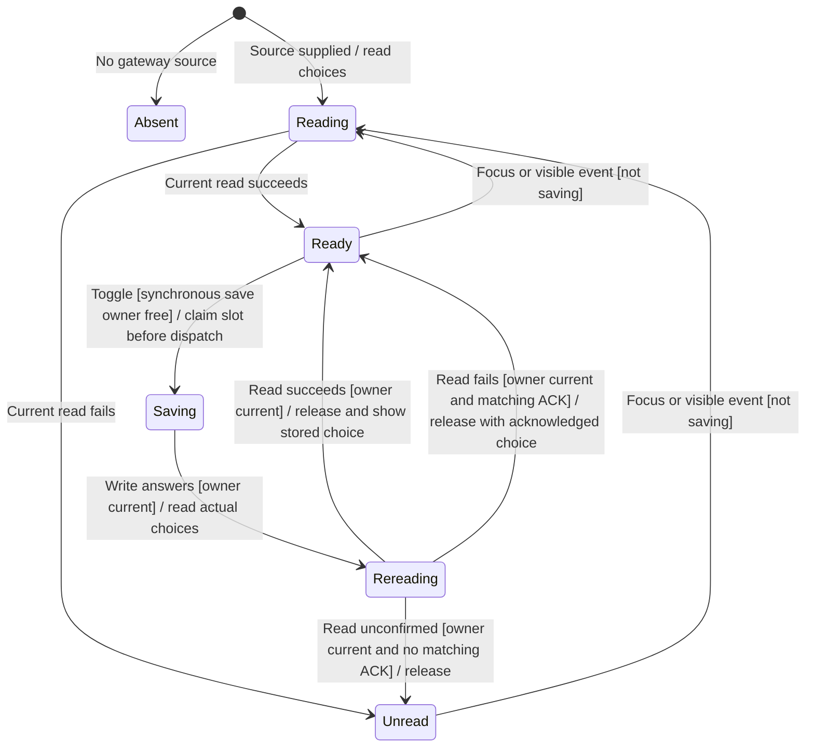

# Configure native harness hooks

Settings → Privacy & Permissions → Native hooks controls whether the next Claude or Codex process start omits Nessa's request to suppress that harness's own hooks. It does not change an already running process. OpenCode has no setting in this flow.

The mounted rows own the displayed choice and pending save. The gateway owns the stored configuration and authorization. Hook behavior can approve, deny or alter tool work outside the ordinary review UI, so the page displays that warning beside the choices.

## What the choice changes

The adapter reads both the stored boolean and whether each harness is configured. A missing catalog entry does not replace the saved choice; the row says the agent is not set up. The gateway remains responsible for whether a change is permitted.

This is a next-start configuration acknowledgement. It is not proof that a live provider restarted or ran hooks. Native hooks and Nessa permission-review policy remain separate owners.

## Saving and rereading

Toggling claims a synchronous request identity before dispatch, displays the proposed choice and disables both switches. Another callback cannot dispatch while that identity owns the write and its mandatory reread, including callbacks before the disabled render commits. The save receives a new request ID. Focus/visibility reads defer to its mandatory reread; earlier reads cannot replace its owner. The Saving node opens the [detailed action-owner chart](settings-action-owners.md).

A successful reread supplies the actual choices even if the write answer was lost. When the read fails but a matching write was acknowledged, the row can retain that acknowledged choice. If neither supplies trustworthy state, it becomes unread. A failed write with a successful reread displays the actual choice and a failure sentence rather than assuming rollback.

## Recovery and lifetime limits

A failed read can recover on focus or becoming visible. Read publication requires a live effect and current request identity. Cleanup retires that identity and removes focus/visibility listeners, so a replacement source reads independently. A retired save cannot start its reread; an already-started retired reread cannot publish or unlock the replacement's action. No cancellation port stops an admitted gateway save.

Controlled same-task callbacks and provider replacement are covered by regressions. Ordinary production provider replacement and real next-start harness effects remain unproven. Retiring publication does not undo a configuration write. These boundaries differ from server authorization and physical cancellation.

## Evidence and execution limits

[Rendered rows](../../../../../src/desktop/settings/ui/native-hooks-rows.test.tsx) cover stored choices, refusal, a lost write answer, missing catalog entries, focus refresh and overlapping reads. [Adapter tests](../../../../../src/desktop/settings/adapters/native-hooks-gateway.test.ts) cover reading and writing through the agents API. The rows now also cover repeated input, ownership through rereading, source replacement and unmount. [Action-owner evidence](settings-action-owners.md) distinguishes those controlled cases from live next-start behavior and production rebinding. This page was re-reviewed against the assembled source checkpoint; unrelated pages retain their earlier checkpoints.
