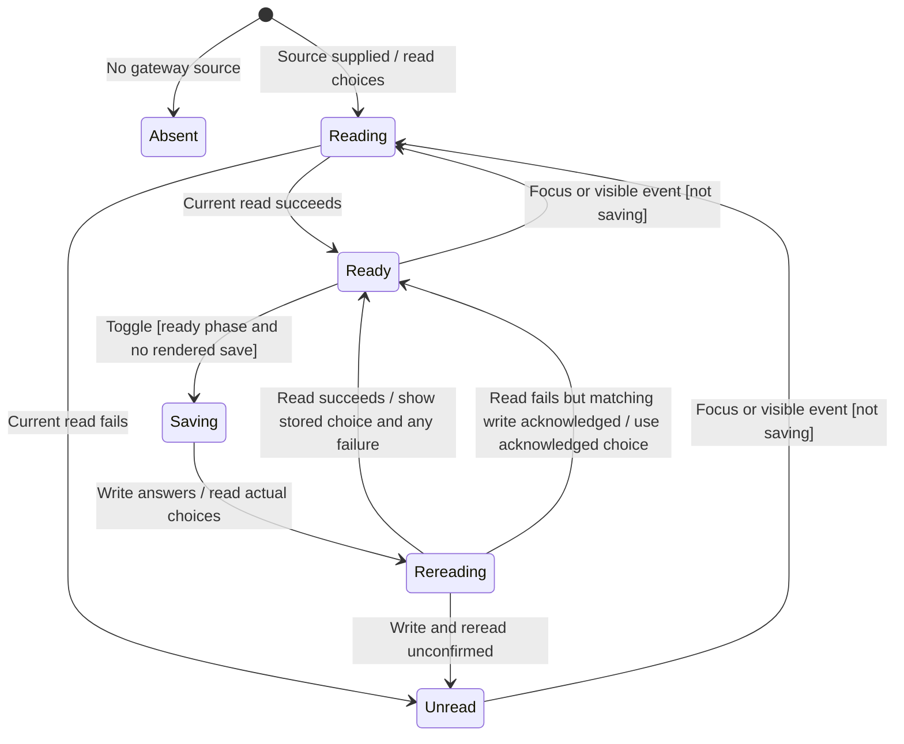

# Configure native harness hooks

Settings → Privacy & Permissions → Native hooks controls whether the next Claude or Codex process start omits Nessa's request to suppress that harness's own hooks. It does not change an already running process. OpenCode has no setting in this flow.

The mounted rows own the displayed choice and pending save. The gateway owns the stored configuration and authorization. Hook behavior can approve, deny or alter tool work outside the ordinary review UI, so the page displays that warning beside the choices.

## What the choice changes

The adapter reads both the stored boolean and whether each harness is configured. A missing catalog entry does not replace the saved choice; the row says the agent is not set up. The gateway remains responsible for whether a change is permitted.

This is a next-start configuration acknowledgement. It is not proof that a live provider restarted or ran hooks. Native hooks and Nessa permission-review policy remain separate owners.

## Saving and rereading

Toggling displays the proposed choice and disables both switches while saving. The handler declines a request whose captured phase already names a save. A save receives a new request ID and the component then rereads. Background focus/visibility reads do not compete while the saving flag is held; earlier read generations cannot replace the pending save.

A successful reread supplies the actual choices even if the write answer was lost. When the read fails but a matching write was acknowledged, the row can retain that acknowledged choice. If neither supplies trustworthy state, it becomes unread. A failed write with a successful reread displays the actual choice and a failure sentence rather than assuming rollback.

## Recovery and lifetime limits

A failed read can recover on focus or becoming visible. The read effect has a lifetime guard and generation comparison; its listener cleanup removes focus and visibility handlers. No cancellation port stops an admitted gateway save.

The current write continuation does not carry a separate source-lifetime identity, and rendered disabling is not proof of synchronous coalescing before React commits it. This audit does not establish repeated-click or cross-source late-save safety. Those are concrete remaining validation boundaries, not a claim that the remembered-rule revoke fix also changed native hooks.

## Evidence and execution limits

[Rendered rows](../../../../../src/desktop/settings/ui/native-hooks-rows.test.tsx) cover stored choices, refusal, a lost write answer, missing catalog entries, focus refresh and overlapping reads. [Adapter tests](../../../../../src/desktop/settings/adapters/native-hooks-gateway.test.ts) cover reading and writing through the agents API. Live harness next-start behavior and the repeated-input/lifetime boundaries above are not established by those UI/adapter tests. No new runtime behavior is proposed by this chart.
