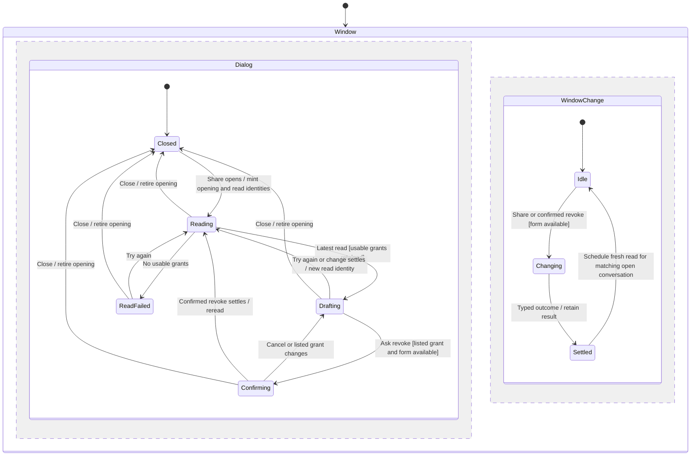
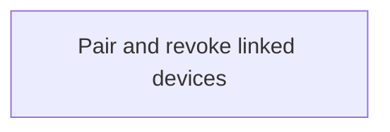

# Share a conversation and revoke its grant

A conversation's Share dialog lists its existing grants and offers eligible linked devices. It can grant Read, Comment or Drive, with Drive tool constraints. The gateway decides what the current owner may grant; a local role choice is not authority.

The dialog's lifetime differs from an admitted change's lifetime. Closing the dialog discards its reads and draft. The window retains a pending share/revoke until it settles, so reopening or switching conversations cannot start a competing change.

## Read grants and eligible devices

Each read names both the dialog opening and its own request identity. Only the newest read of the current opening applies. Closing and reopening a dialog cannot revive an old read. The grants and eligible-device/host choices are read separately, so failure of choices can leave existing grants visible and revocable.

The gateway adapter reads grant pages on one connection and one catalogue revision. A later page at another revision discards the accumulated pages and restarts, at most twice. Duplicate credentials, excess rows or continued revision drift become an unanswered read. The [D12 cases](../../../../../src/desktop/workspace/adapters/gateway/sharing-gateway.test.ts) exercise that boundary.

## Draft basis and confirmation

A change is built from the current store draft. The draft retains the grant revision on which it was based; a later read from another writer does not silently move that basis. A stale basis is refused by the gateway as Changed, and Start Again deliberately rebuilds it from the current listed grant.

Revoke captures the credential and policy revision when confirmation opens. A reread that removes or changes that grant ends the confirmation. Confirming names that captured revision, so another writer's update is not silently revoked. The shared form-held predicate blocks edits and changes while a window mutation, read or required post-change listing is unresolved.

## Change ownership survives dialog closure

Only one share/revoke change is in flight per window, including across dialog openings and conversations. Closing the dialog does not cancel an admitted gateway operation. Its eventual outcome can update a newly opened dialog for the same conversation and trigger a new read; a dialog on another conversation does not inherit its result.

The concurrent chart regions model that independent ownership, not separate threads. The form-available guard reads both regions through the owning workspace state. An enclosing Window end does not establish whether a remote change committed; the chart makes no physical cancellation guarantee.

## Acknowledgement and fresh read

A typed failure can mean refusal or an unanswered outcome. The dialog retains what its own change answered, then rereads regardless. That new list establishes the current grants; acknowledgement alone does not replace it. A failed post-change read holds the form until recovery, preventing another change based on a pre-change list.

Grant publication, device connectivity, receiver synchronization and ongoing agent execution have separate lifetimes. Revoke does not imply erasure of content already downloaded or completion of all previously admitted work. Backend Cedar admission and transactional grant journals are documented in the existing design, outside this bounded desktop source review.

## Evidence and browse

The [D1–D12 design table](../../../../design/read-grants.md#dialog-state-and-order) maps the actual transition owner to unit, store, adapter and rendered-dialog tests. [Store regressions](../../../../../src/desktop/workspace/adapters/store/sharing-commands.test.ts) drive close/reopen, concurrent changes and post-change read failure. [Dialog tests](../../../../../src/desktop/workspace/ui/share/share-dialog.test.tsx) cover confirmation and recovery copy. Existing conversation stress sharing steps remain the gateway/browser integration gate; they were not run in this environment.

