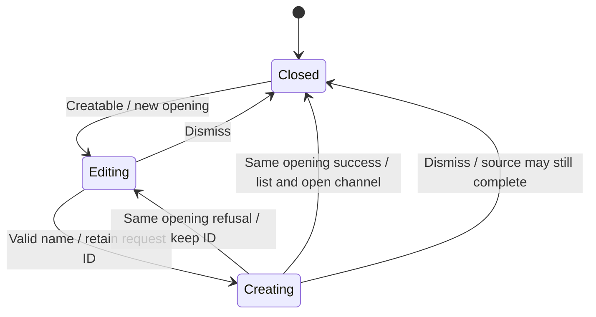

# Create a channel

New channel asks the supported steps over the content region. The window must advertise channel creation. A valid name is required; resource selection deduplicates paths and reports those beyond the published limits. Drops belong to the opening and resource question where they landed.

Create freezes the draft while it is pending. Refusal keeps the request ID so retry of that same draft targets the same channel; editing retires the ID. Closing the flow does not cancel source creation. A late successful channel is still added to the index but cannot navigate a newer opening. This is presentation ownership, not backend authorization or durable idempotency proof.

## Bounded rule model

Two openings distinguish source success from current presentation: late success lists the channel without navigating a replacement dialog. Name, model and resource validation are contracts outside this model; request retry identity is described above but not represented by the opening token. The model checks design safety, not the implementation. It asserts no liveness and abstracts transport timing into nondeterministic completion order. Regression sources are evidence of intended behavior; this documentation change does not claim their execution.

## Model coverage

Disposition: direct model. The bounded rule model section names the modeled owner slice and finite abstraction.

Excluded: All exclusions stated in the owning Bounded rule model section remain outside verification.

Source review scope: owner entry points and relevant regression declarations were inventoried against frozen source `77a6b620af4d94b234294f6d273fd74b3dfb44c7`. Existing source checkpoints are retained where this was a partial review. A model result establishes bounded design safety only. Browser appearance and interaction were not checked.
