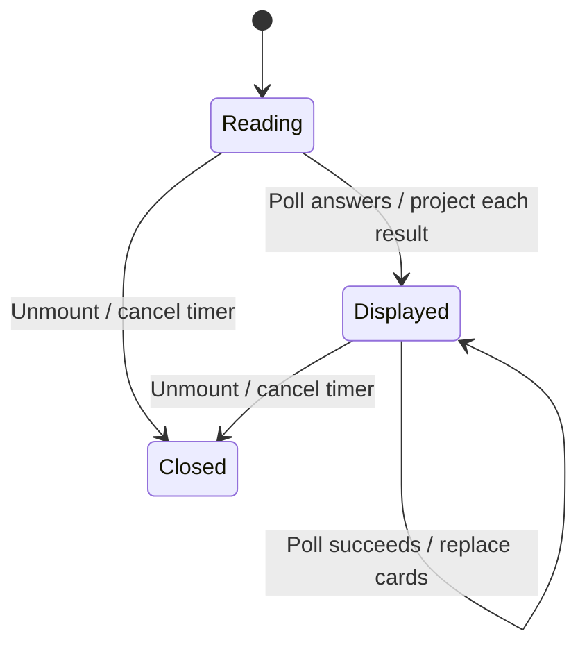

# Inspect devices and add a computer

Devices lists the hub, worker computers, cloud connection and linked clients. Each poll reads device, cloud and linked evidence together. A failed device list retains the preceding hub and worker cards with an unreachable indication; failed cloud or linked reads instead yield absent evidence. Closing the page cancels its timer and discards late read completion. Polls may overlap; there is no revision fence between reads of the same mount, so a slow older poll can replace a newer answer.

Workers show online, draining or offline evidence and resource usage. Offline cards omit usage and count no live agents. Add computer supplies connection instructions; cloud settings reuse Boat connection fields and linked-client setup reuses [linked devices](linked-devices.md). These displays do not allocate a worker or establish authorization. The gateway remains authoritative.

## Bounded rule model

One mounted read demonstrates retention on list failure and refusal to publish after unmount. Repeated overlapping polls and separate cloud/linked failure values are explicitly excluded. No monotonic freshness guarantee is asserted: the source has only a mounted-lifetime guard. The model checks design safety, not the implementation. It asserts no liveness and abstracts transport timing into nondeterministic completion order. Regression sources are evidence of intended behavior; this documentation change does not claim their execution.

## Model coverage

Disposition: direct model. The bounded rule model section names the modeled owner slice and finite abstraction.

Excluded: All exclusions stated in the owning Bounded rule model section remain outside verification.

Source review scope: owner entry points and relevant regression declarations were inventoried against frozen source `77a6b620af4d94b234294f6d273fd74b3dfb44c7`. Existing source checkpoints are retained where this was a partial review. A model result establishes bounded design safety only. Browser appearance and interaction were not checked.

See [pool ordering](choose-worker-pool-order.md) for the newer order editor, exclusions and placement decisions. The polling model on this page does not cover those controls.
