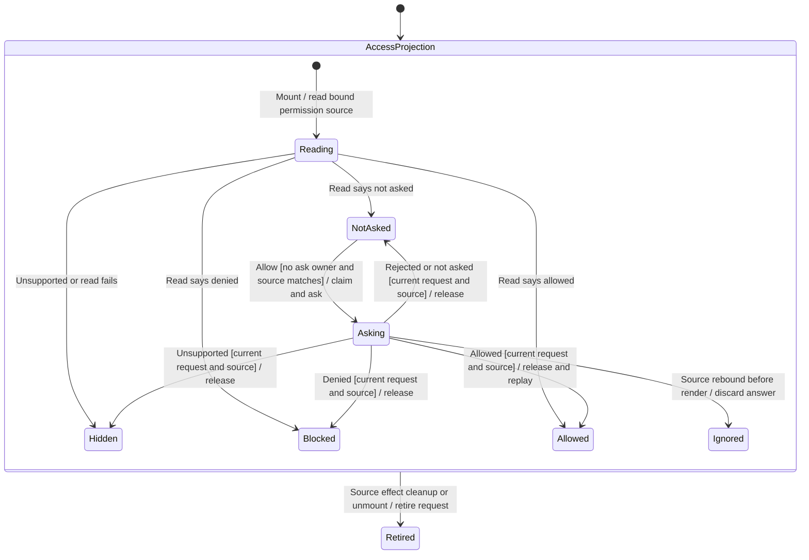

# Enable waiting-review notifications

Settings → Privacy & Permissions → Access can ask permission to show notifications for reviews waiting on a person. In a browser the browser owns that permission; native composition can bind the host's permission source. Permission to notify is not approval of the agent's tool request.

The chart follows the Settings access projection. The waiting-review snapshot and the system notification have separate lifetimes. Reading access on mount does not display a permission prompt; Allow initiates the prompt from the person's own gesture.

## Permission starts with the Allow gesture

Unsupported platforms omit the rows. Denied access shows the source's instructions for enabling notifications in browser or system settings. Only the not-asked state offers Allow, and that click calls the bound permission source directly.

Allow installs a synchronous ask identity before calling the permission API and disables the button until settlement. Repeated callbacks cannot dispatch another ask while it owns the slot. The Asking node opens the [detailed action-owner chart](settings-action-owners.md). This establishes API admission, not how many visible prompts the platform chooses to show.

## Granting access and waiting reviews

A grant updates the Settings label and asks the active gateway-notice binding to show its latest waiting-review snapshot only when the request identity and currently bound access source still match. That includes a review received before permission was granted. If no gateway binding exists, there is no waiting-review replay to perform.

The snapshot owner compares conversation, execution and permission identity: arrivals show notices and departures clear them. A notice already held by the notifier is not shown twice. Selecting a notice opens its conversation; it does not answer the review. Delivery through browser/OS APIs and the actual permission decision remain separate from the local grant callback.

## Refusal, recovery and retirement

A rejected prompt keeps Allow available for another attempt. A denied result directs the person to external permission settings; this mounted component does not continuously subscribe to permission changes there. A later mount or bound-source change reads again.

Initial reads and asks ignore results after their request identity retires. Source-effect cleanup or unmount retires it; a replaced source reads independently. A source rebound before the next render also fails the current-source check. Its discarded answer leaves the old row pending until the replacement source renders; no reactive binding subscription is added. Cleanup neither cancels a platform prompt nor withdraws granted permission. Replacing only the replay callback for the same active view/access source is not modeled as view retirement.

## Evidence and execution limits

[Settings tests](../../../../../src/desktop/settings/ui/review-notice-rows.test.tsx) cover unsupported access, explicit Allow, replay for an already waiting review, native-host delegation and blocked copy. [Notice-owner tests](../../../../../src/desktop/workspace/adapters/gateway/review-notices.test.ts) cover snapshot and notifier behavior. The row regressions now also cover API coalescing, rejected/not-asked retry, stale completion, remount and source replacement. Real OS/browser prompt display and ordinary production rebinding remain unverified. [Action-owner evidence](settings-action-owners.md) records the controlled cases; MCP App review or iframe checks do not establish permission enablement.
