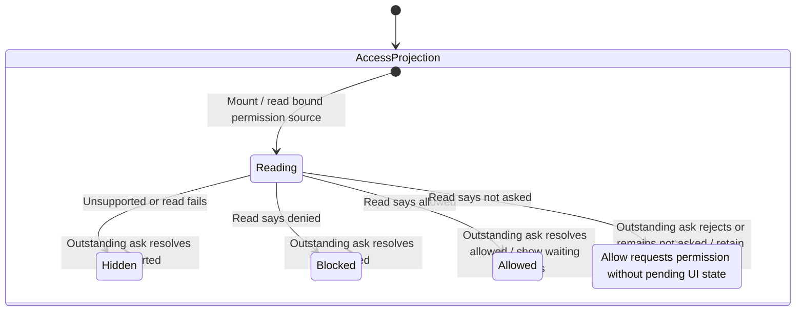

# Enable waiting-review notifications

Settings → Privacy & Permissions → Access can ask permission to show notifications for reviews waiting on a person. In a browser the browser owns that permission; native composition can bind the host's permission source. Permission to notify is not approval of the agent's tool request.

The chart follows the Settings access projection. The waiting-review snapshot and the system notification have separate lifetimes. Reading access on mount does not display a permission prompt; Allow initiates the prompt from the person's own gesture.

## Permission starts with the Allow gesture

Unsupported platforms omit the rows. Denied access shows the source's instructions for enabling notifications in browser or system settings. Only the not-asked state offers Allow, and that click calls the bound permission source directly.

The component does not set a pending-prompt state or serialize repeated Allow clicks. The state description records that the displayed state remains not asked while the promise is outstanding. The shared outer transitions also allow a later outstanding answer to replace a value already shown by another answer; no request-generation guard selects a winner. This does not prove that the platform shows only one prompt.

## Granting access and waiting reviews

A grant updates the Settings label and asks the active gateway-notice binding to show its latest waiting-review snapshot. That includes a review received before permission was granted. If no gateway binding exists, there is no waiting-review replay to perform.

The snapshot owner compares conversation, execution and permission identity: arrivals show notices and departures clear them. A notice already held by the notifier is not shown twice. Selecting a notice opens its conversation; it does not answer the review. Delivery through browser/OS APIs and the actual permission decision remain separate from the local grant callback.

## Refusal, recovery and retirement

A rejected prompt keeps Allow available for another attempt. A denied result directs the person to external permission settings; this mounted component does not continuously subscribe to permission changes there. A later mount or bound-source change reads again.

The initial read ignores its result after effect retirement. An outstanding Allow promise has no cancellation or separate live guard: a late allowed result can still invoke the currently bound waiting-review replay. This chart does not claim stale-prompt isolation, recursive cleanup, or withdrawal of permission on navigation away.

## Evidence and execution limits

[Settings tests](../../../../../src/desktop/settings/ui/review-notice-rows.test.tsx) cover unsupported access, explicit Allow, replay for an already waiting review, native-host delegation and blocked copy. [Notice-owner tests](../../../../../src/desktop/workspace/adapters/gateway/review-notices.test.ts) cover snapshot and notifier behavior. Real OS/browser prompt delivery, concurrent Allow requests and late prompt settlement are separate validation boundaries; permission enablement is not covered merely by an MCP App permission review or iframe check.
