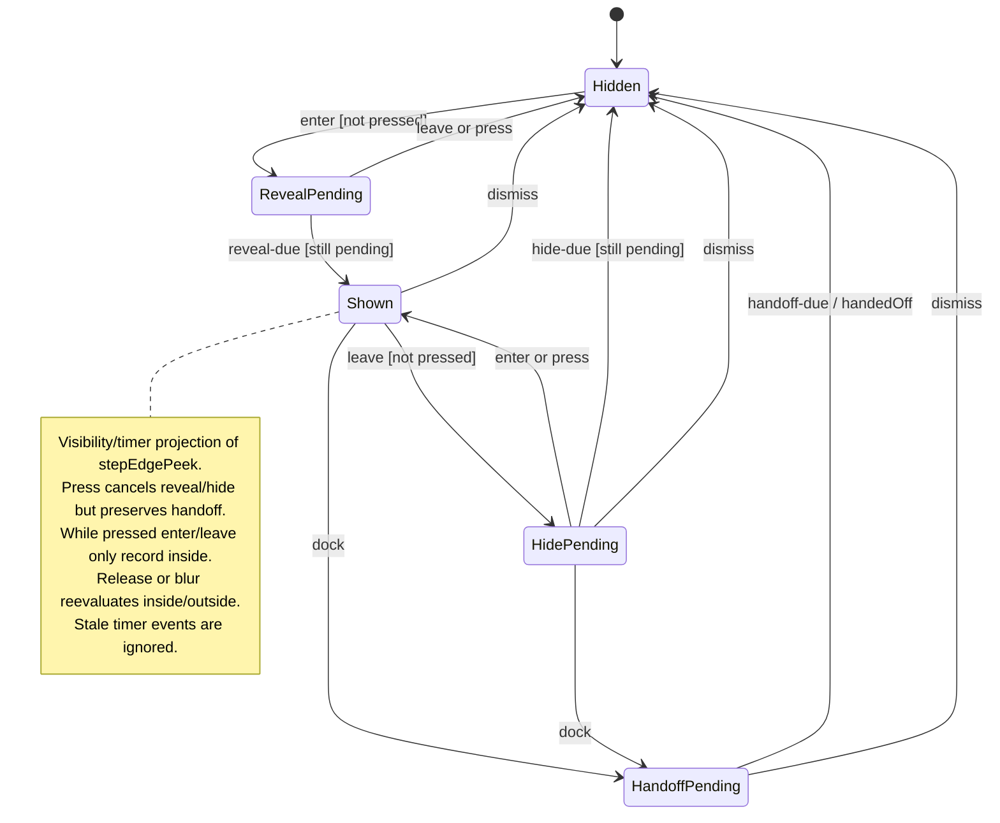

# fold, reveal, and resize side columns

Side columns can be resized or folded to make room for the workspace. Reveal brings a folded column back into view without permanently changing the layout.

At the left edge, a temporary overlay can show the column. Leaving it starts a short delay before it hides. Keyboard controls and available screen width also affect which columns can remain open.

## Layout observer orderings (#693)

| Ordering | Result | Regression |
| --- | --- | --- |
| Column title widths arrive during ResizeObserver delivery | Record widths without changing DOM. One animation-frame callback commits the latest placement before the next paint. | `column-header.test.tsx`, latest-width delivery |
| Several width reports arrive before that frame | Use the newest measurements with one pending frame. | Same test, `width.test.tsx` |
| Overview layer crosses its width threshold | Commit the arrangement outside observer delivery. Focus follows the resulting layout commit. | `width.test.tsx`, overview narrowing regression |
| An observed header or layer unmounts with a frame pending | Disconnect its observer and cancel the frame. | Header and width cleanup assertions |
| A late page error remains at close | Its console result keeps the actual engine and selected layout, so the engine summary also fails. | Scripted WebKit observer revert probe |

## Further reading

[Source](../../../../../src/desktop/workspace/application/usecases/navigation.ts) · [Related source](../../../../../src/desktop/workspace/model/window-fit.ts) · [Related tests](../../../../../src/desktop/workspace/application/usecases/navigation.test.ts)

## Model coverage

Disposition: direct model. The bounded rule model section names this owner, its guarded transitions and the finite design checked. Pure value parsing and geometry stay with the linked source contracts. No claim is made that a checked design is an implementation proof.

The source owner and regression intent were traced at `77a6b620af4d94b234294f6d273fd74b3dfb44c7`; older page checkpoints are retained where the wider journey was only partially re-reviewed. No browser or application-test execution is claimed.

## Bounded rule model

The SideColumn owner is shared by workspace columns and Settings sidebar. User choice and automatic folding are separate facts: a fit never changes chosen visibility, room restores only a chosen-open column, and a manual show clears folding immediately until the next geometry fit. Dragging beyond the snap threshold is modeled as another Choose event; exact widths, the 40-pixel threshold and sidebar-before-list fitting are geometry contracts tested in window-fit and side-column suites. The model checks design safety, not the implementation. It asserts no liveness and abstracts transport timing into nondeterministic completion order. Regression sources are evidence of intended behavior; this documentation change does not claim their execution.
