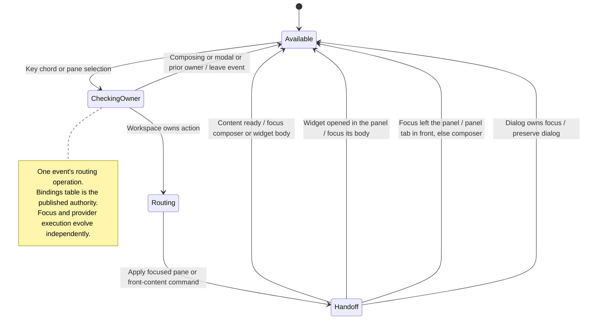

# follow focus and route keyboard actions

Keyboard actions follow the current focus. A pane, input or open widget can handle an action before the wider workspace handles it.

Nessa uses the same published shortcuts for keyboard and visible controls. Focus determines the target, so a key should not accidentally act on a different conversation or pane.

The window's document strip is reachable from the toolbar. Arrow keys and
Home/End select tabs; choosing a document focuses its existing pane or shows
it in the focused pane. Closing a tab by keyboard moves focus to another tab
or the next toolbar control.
Arrow selection keeps the caret on the selected document tab. When New Session
or Split Right deselects that tab, the caret follows the new focused pane into
its composer.

A widget opened in the chat's right panel takes the caret into its body. When focus falls out of the panel, for example because its last tab closed, it goes to the panel's tab in front, else to the focused chat's composer. ⌘1 to ⌘9 on the pane that is already focused brings the caret back to it from the panel, and from the overview or a widget over the window goes back to the panes.

## Further reading

[Source](../../../../../src/desktop/workspace/ui/layouts/shortcuts.ts) · [Related source](../../../../../src/desktop/workspace/adapters/dom/shortcuts.ts) · [Related tests](../../../../../src/desktop/workspace/adapters/dom/focus.test.tsx)
