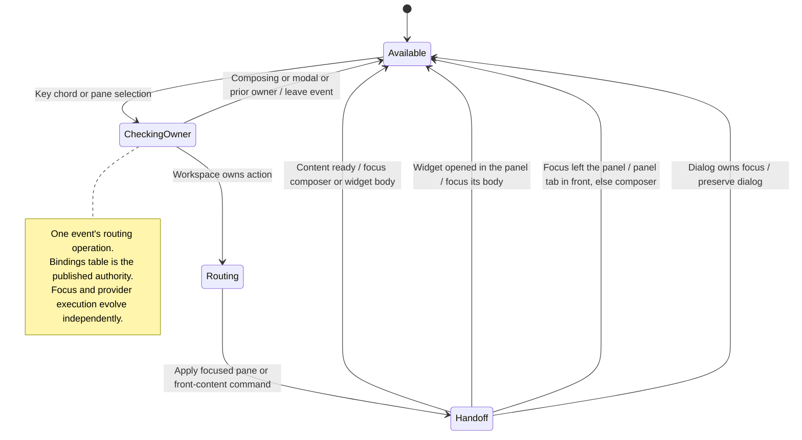

# follow focus and route keyboard actions

Keyboard actions follow the current focus. A pane, input or open widget can handle an action before the wider workspace handles it.

Nessa uses the same published shortcuts for keyboard and visible controls. Focus determines the target, so a key should not accidentally act on a different conversation or pane.

A widget opened in the chat's right panel takes the caret into its body. When focus falls out of the panel, for example because its last tab closed, it goes to the panel's tab in front, else to the focused chat's composer. ⌘1 to ⌘9 on the pane that is already focused brings the caret back to it from the panel, and from the overview or a widget over the window goes back to the panes.

## Further reading

[Source](../../../../../src/desktop/workspace/ui/layouts/shortcuts.ts) · [Related source](../../../../../src/desktop/workspace/adapters/dom/shortcuts.ts) · [Related tests](../../../../../src/desktop/workspace/adapters/dom/focus.test.tsx)

## Model coverage

Disposition: direct model. The bounded rule model section names this owner, its guarded transitions and the finite design checked. Pure value parsing and geometry stay with the linked source contracts. No claim is made that a checked design is an implementation proof.

The source owner and regression intent were traced at `77a6b620af4d94b234294f6d273fd74b3dfb44c7`; older page checkpoints are retained where the wider journey was only partially re-reviewed. No browser or application-test execution is claimed.

## Bounded rule model

This model follows the shared focusAfterPaint owner through target discovery, a paint gap, store/DOM-mark disagreement, deliberate focus movement and retirement. Two pane identities allow a captured field to become stale before landing. Landing requires current identity, agreement with the painted pane and retained focus authority. Search retries are abstracted without asserting eventual focus. Inert and modal checks use the blocked-authority branch; pixel geometry is a separate contract. Quick-switcher cleanup calls the same cancellation mechanism. The concrete regressions cover replaced composers, cancellation, inert targets, modal focus, stale store settlement and deliberate movement before target search. The model checks design safety, not the implementation. It asserts no liveness and abstracts transport timing into nondeterministic completion order. Regression sources are evidence of intended behavior; this documentation change does not claim their execution.
