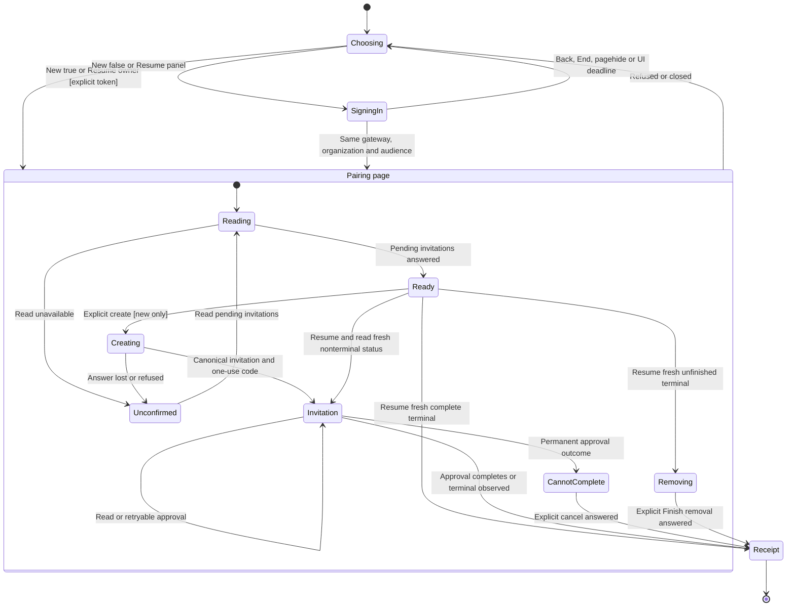

# Pair a gateway with explicit Human sign-in

Devices → Add device → Gateway invites a gateway that reads separately shared
conversations. The person chooses whether both gateways belong to them before
creating the invitation. Phone and Computer keep their existing consent classes.

A true choice asks for the Human owner's token on this page. The normal panel
connection keeps its Integration identity. A separate session opens at the
panel's current endpoint, checks the gateway and organization, and exposes only
pairing methods to the view. The credential registry decides whether the owner
is Human. An administrator role or a caller label cannot supply that fact.

The chart follows the page’s operation, not the registry phase machine. An
uncertain read does not change the canonical phase.

A terminal observation discards the old code and activation notice, retires the
old scope and stops polling. Cleanup pending remains an honest unfinished
receipt. A fresh explicit resume reads status again and retains its new scope
only for unfinished removal through Finish removal. Ending the UI scope does
not claim the native cleanup committed.

Status, one-use code, exact approval outcome and the keyed fingerprint are one
immutable selected-invitation value. Create and explicit resume replace it; reads
carry details only for the same invitation, and fingerprints match both the
invitation and claimed key. End, pagehide and the UI deadline clear the whole
value, preventing a later invitation from inheriting an old permanent outcome.
This is UI presentation data, not a second registry or admission lifecycle.

Entry, new selection, permanent stop and receipt changes hand focus to the page
region; a ready new invitation focuses Create. Repeated status reads preserve
the selected control. Uncertain answers direct the always-visible Back action
to reopen Gateway and resume canonical invitations.

The invitation label uses the server's saved choice, including false. Absence
is unknown. A recovered invitation has no code. Cancel and create another to
change the choice or obtain a new code; recovery does not relabel the old one.
Only one operation runs at a time. Polling reads cannot replace a later command
answer, and a closed generation ignores late responses. A lost create answer
requires a successful pending read before another create is offered.

Approval can return Active while attribution remains owed. A retryable outcome
then offers Retry activation and says attribution is unconfirmed. A permanent
outcome removes retry and directs cancellation/new pairing. The exact stop is
retained across same-invitation polls. A fresh resume has canonical status,
which does not carry the earlier session’s stop; explicit approval obtains a
current result from the existing authority. The
[gateway authority](../../gateway/same-person.md) commits the credential and
receiver before the link and audit, and retry keeps those identities. Neither
Active nor the saved choice is presented as a share or a committed person link.
The existing Linked devices credential revoke removes attribution.

The page clears its token input on submission and retains no application storage
or URL credential. Its separate client disables reconnect. Completion, observed
terminal status,
End pairing sign-in, navigation, pagehide and the scheduled ten-minute UI timer
close that client. The timer depends on the browser event loop and does not
expire credentials or impose a server session TTL. Aborting connection or
identity reads promptly detaches this scope from shared panel work; late owned
connection completion closes before exposing commands. JavaScript
string zeroization is not promised. An unfinished invitation stays with the
registry and requires fresh explicit sign-in after reopening.

Source review checkpoint: `49112732e8e7b08fc4190ef771511c389f484087`. This page reconciles
the new Devices entry, immutable display selection, scoped adapter, composition,
SDK endpoint and focused regressions. Current main's ambient elapsed clock is
separate from this flow's injected `after` timer; the integration adds no pairing
state or authority. The upstream Place refactor changes no pairing, principal,
grant, admission or wire contract. Mandatory harness corrections preserve the
catalogue and read-only inventory contracts. The source checkpoint is a review record,
not an execution receipt. Native lifecycle, unrelated desktop pages and the
OwnerPhone model keep their own earlier checkpoints. Browser and mutation
receipts are in [completion evidence](../../../../reviews/893-desktop-completion.md).
The chart has no formal model. It does not refresh the separate OwnerPhone model
or claim to verify native host IPC, WKWebView, or deployed gateways.
