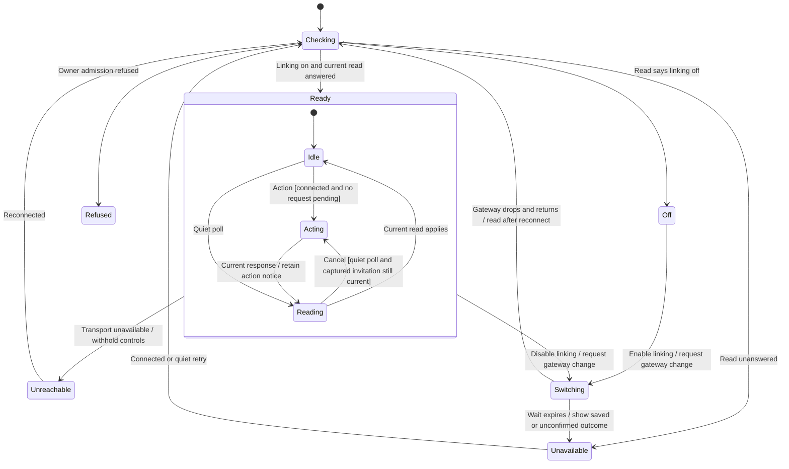
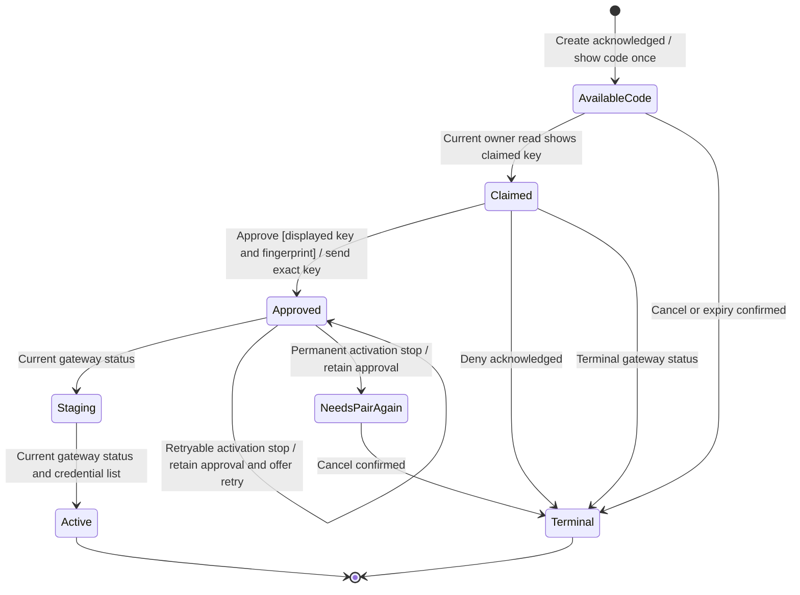
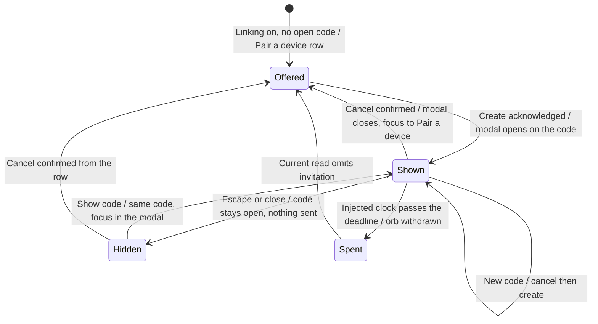
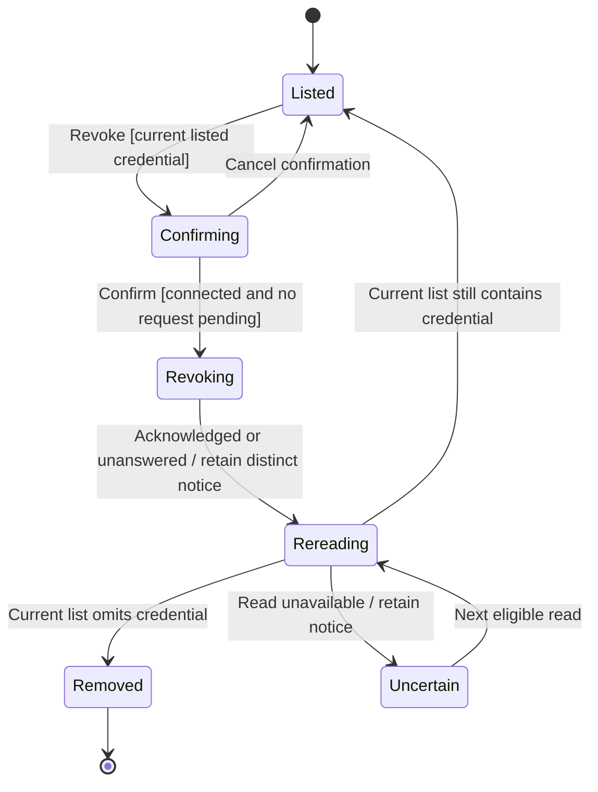
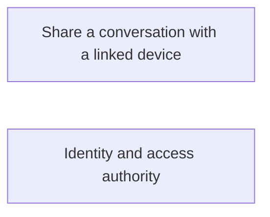

# Pair, approve and revoke a linked device

Settings → Connections → Linked devices shows the gateway's current linking state. Pair a device asks for a short-lived code; a claimed request shows a fingerprint for approval or denial. A paired owner phone has full conversation access. A PeerRead gateway requires separate conversation shares; a same-person link adds no capability.

These charts follow the desktop reducer and its displayed invitation/device evidence. The gateway remains the authorization and physical enrollment owner. A sample window without a gateway offers no pairing action.

## Connection and request ownership

The reducer owns one current result and gives its request a sequence number. Only a reply matching that pending request can apply. Cancel may supersede a quiet poll while its read still physically runs. The old poll's reply cannot apply before or after cancellation and its reconciliation read. Other actions wait for the pending request; Cancel also waits for mutation-recovery reads, a linking restart or revoke confirmation. A poll does not erase an action's notice; an initial failed read can recover on a later poll.

Cancel carries the invitation identity displayed by the control. The reducer accepts it only while that invitation is still held. If a poll removes invitation A or replaces it with B before cancellation is admitted, the old A command is ignored. Cancel controls also change DOM identity with the invitation, so a gesture begun on A cannot be rebound to B. The adapter sends the captured identity to the gateway, which remains the cancellation authority.

Turning native linking on or off can restart the gateway. The switch holds the requested value through that restart and waits for a read after the connection has dropped. A lost acknowledgement does not prove the setting was unsaved. The restart deadline supplies a stalled/unconfirmed notice, not proof of process termination. UI unmount removes connection observers and timers; it does not undo an admitted gateway command.

## Approve the displayed key

Approve requires both the claimed key and its computed fingerprint. The command captures that exact key with the invitation identity. Without a fingerprint, approval is withheld while denial remains available. The gateway decides whether that invitation and key may be approved; the UI does not replace that authorization rule.

A code is returned once by creation and retained only in the mounted UI. A later pending read may show an invitation without recovering its secret. The view says the code was not shown rather than inventing one. Refresh first cancels the old invitation; a failed cancel prevents creation of another code.

## Approval is not activation

Approval can be committed while receiver staging or activation still needs work. A retryable activation stop offers retry; a permanent stop asks for cancellation and pairing again. NeedsPairAgain is a recovery instruction while approval can still be retained. Terminal requires a later cancellation or terminal enrollment status. Neither instruction proves that a previously approved credential has already been revoked.

A current read can skip intermediate phases shown in the chart. These boxes are evidence values, not a promise that the window observed every gateway step.

## The code's modal

The reducer owns the code's state (open, used, cancelled, expired). Whether the modal shows it is view state only: closing remembers which invitation was closed, so the row offers Show code for that code, and a new code opens the modal again. Closing sends nothing. A device that uses the code is approved inside the modal, and a notice is said there while the modal is up.

The orb is drawn only for an open code whose deadline the window's injected clock (`useNow`, given by composition) has not passed, read again each second; the UI kit's countdown also reports expiry, which the reducer asks the gateway to record. The modal portals into Settings' own layer so it draws above the fixed Settings panel. The pairing screen handles the dialog's close-focus event and returns focus to the row's enabled control, or waits on the row while a read is out. That destination also holds when a pointer click left focus on an unrelated settings control before the dialog opened.

The active list is built from current credential metadata, excluding the session credential and revoked credentials. `linkedDeviceOf` recognizes an exact grant-action shape: read alone, or read/write/server-read in the issued order; the row labels the latter as full access. The current metadata has no device marker or consent class, so it does not establish whether a row is a PeerRead gateway, a legacy DeviceRead credential, or a manually issued credential with the same actions. DeviceRead names the owner; PeerRead names the gateway principal. The gateway decides admission and share eligibility from its authoritative records. Creating a code here requests owner-phone enrollment; approval still names the displayed device key.

Web-tunnel controls share the adapter and Settings surface but have a separate [connectivity owner](../../gateway/tunnel-connectivity.md). Their lifecycle is outside these charts.

## Revoke and recover uncertainty

Revoke asks for confirmation before dispatching. Its result is followed by a current read, including when acknowledgement was lost. The view distinguishes a confirmed revoke from an uncertain one rather than removing the row optimistically.

Revocation takes effect at later server admission/read boundaries; the UI acknowledgement is not proof that all previously admitted work or sockets have physically ended. Sharing grants have a separate lifecycle and are inspected through the conversation's Share dialog.

## Evidence and browse

The [L1–L33 ordering table](../../../../design/auth/device-pairing.md#desktop-linked-devices) maps the reducer, adapter and UI regressions. [Reducer tests](../../../../../src/desktop/settings/model/linked-devices.test.ts) cover sequence refusal, unavailable controls and uncertain outcomes. [Cancellation ordering tests](../../../../../src/desktop/settings/model/linked-devices-cancel.test.ts) cover quiet-poll supersession, late replies, protected recovery reads and stale captured invitation identities. [UI tests](../../../../../src/desktop/settings/ui/linked-devices-tab.test.tsx) check displayed fingerprint, revoke confirmation, the modal's close and reopen, focus return, and the orb leaving at the injected clock's deadline. This source review does not rerun native OPAQUE/TLS enrollment or establish physical receiver cleanup.

## Bounded rule model

Two displayed keys cover fingerprint-gated approval of the captured key. A linking restart settles only after the old connection dropped. Invitation expiry, modal secret retention, cancel-before-refresh, activation retry and credential revocation are separate gateway/UI contracts and not checked by this abstraction. Quiet-poll supersession, cancellation sequence fencing, captured Cancel invitation identities and keyed DOM controls are also outside the model. The model checks design safety, not the implementation. It asserts no liveness and abstracts transport timing into nondeterministic completion order. Regression sources are evidence of intended behavior; this documentation change does not claim their execution.

## Model coverage

Disposition: direct model. The bounded rule model section names the modeled owner slice and finite abstraction.

Excluded: All exclusions stated in the owning Bounded rule model section remain outside verification.

Source review scope: the complete page was reconciled with the reducer, UI,
adapter, metadata classifier, Settings layer and regression declarations at
`d5fb8be1166e016ea64dabf239ed8b11c504b08a`. These desktop sources are unchanged since
`ea66af43`; the integration retains main's named-computer placement beside the
gateway-pairing stress entry. Quiet-poll cancellation, captured targets and keyed
DOM controls keep their existing owner and ordering. The subsequent attachment
and peer-gateway crate extractions change composition imports, not these
desktop ordering owners.

The diagram bodies are unchanged. The earlier six-diagram Chromium rendering
receipt keeps its source cut. This source review does not refresh the historical
model source mapping, model files or checker receipt and makes no new execution
claim. A model result establishes bounded design safety only.

The gateway [pairing owner](../../gateway/device-pairing.md) separately models approval versus activation with current receiver proof. The desktop key-display/restart model does not certify activation or credential cleanup.
