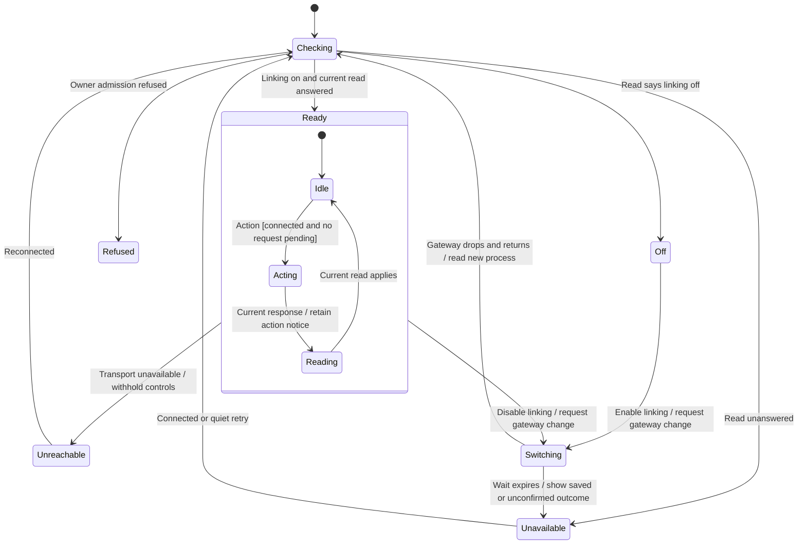
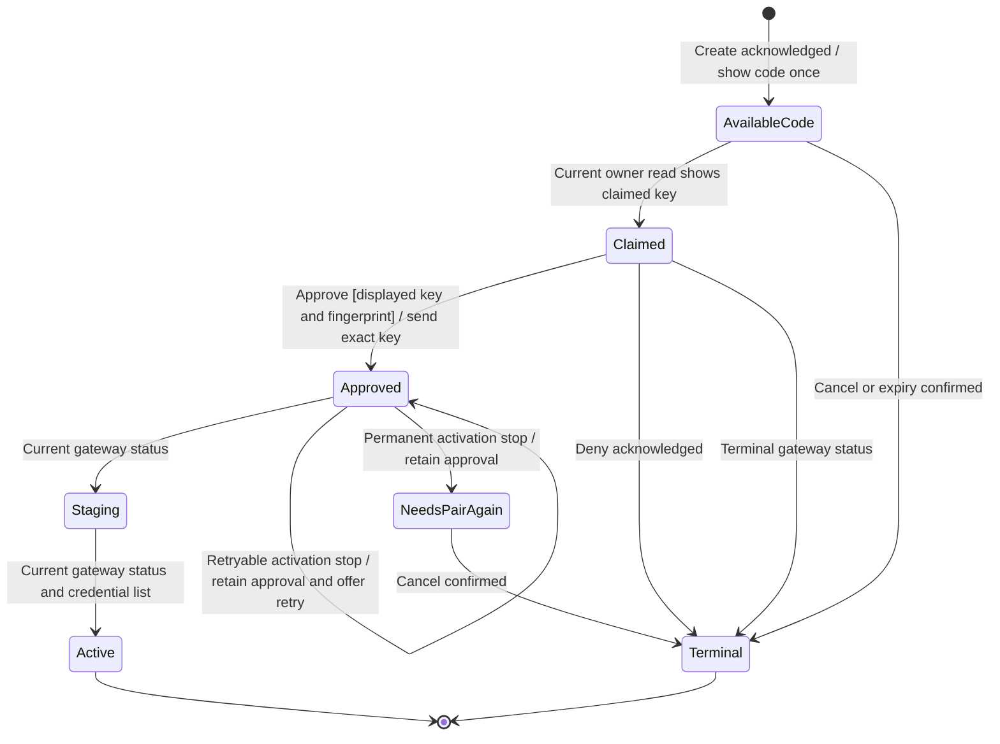
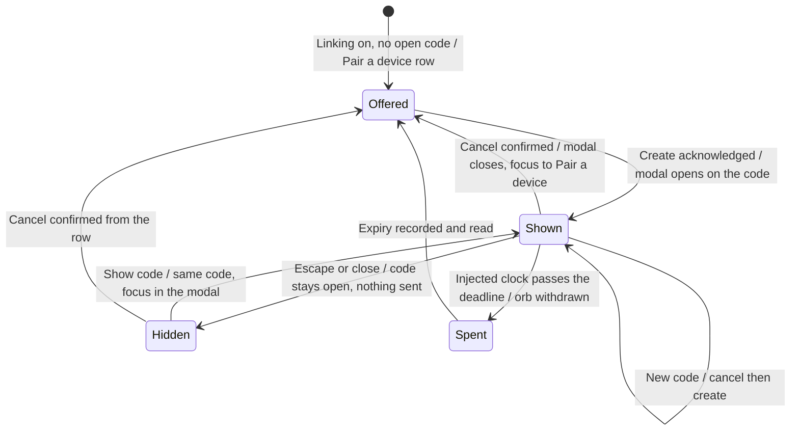
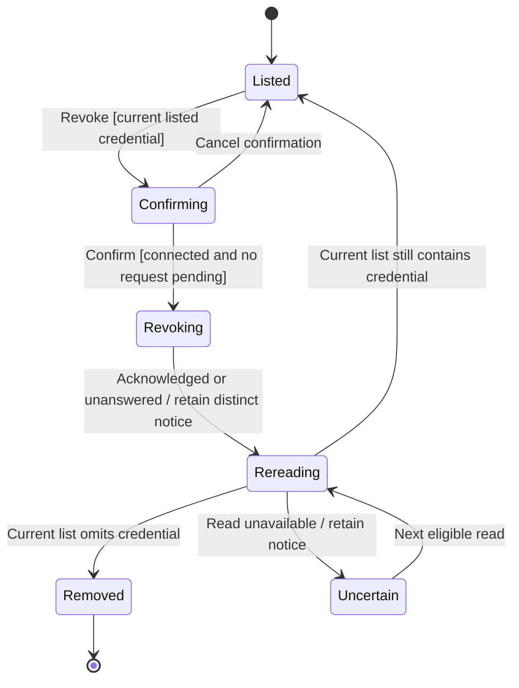
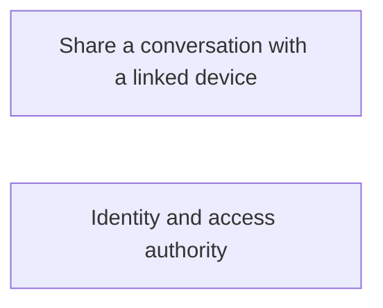

# Pair, approve and revoke a linked device

Settings → Connections → Linked devices shows the gateway's current linking state. Pair a device asks for a short-lived code; a claimed request shows a fingerprint for approval or denial. Device access is then managed separately from which conversations it may read.

These charts follow the desktop reducer and its displayed invitation/device evidence. The gateway remains the authorization and physical enrollment owner. A sample window without a gateway offers no pairing action.

## Connection and request ownership

The reducer owns one request at a time and gives it a sequence number. Only a reply matching the pending request can apply. Polling pauses for pending requests, revoke confirmation or a linking restart. A poll does not erase an action's notice; an initial failed read can recover on a later poll.

Turning native linking on or off can restart the gateway. The switch holds the requested value through that restart and waits for a read after the connection has dropped. A lost acknowledgement does not prove the setting was unsaved. The restart deadline supplies a stalled/unconfirmed notice, not proof of process termination. UI unmount removes connection observers and timers; it does not undo an admitted gateway command.

## Approve the displayed key

Approve requires both the claimed key and its computed fingerprint. The command captures that exact key with the invitation identity. Without a fingerprint, approval is withheld while denial remains available. The gateway decides whether that invitation and key may be approved; the UI does not replace that authorization rule.

A code is returned once by creation and retained only in the mounted UI. A later pending read may show an invitation without recovering its secret. The view says the code was not shown rather than inventing one. Refresh first cancels the old invitation; a failed cancel prevents creation of another code.

## Approval is not activation

Approval can be committed while receiver staging or activation still needs work. A retryable activation stop offers retry; a permanent stop asks for cancellation and pairing again. NeedsPairAgain is a recovery instruction while approval can still be retained. Terminal requires a later cancellation or terminal enrollment status. Neither instruction proves that a previously approved credential has already been revoked.

A current read can skip intermediate phases shown in the chart. These boxes are evidence values, not a promise that the window observed every gateway step.

## The code's modal

The reducer owns the code's state (open, used, cancelled, expired). Whether the modal shows it is view state only: closing remembers which invitation was closed, so the row offers Show code for that code, and a new code opens the modal again. Closing sends nothing. A device that uses the code is approved inside the modal, and a notice is said there while the modal is up.

The orb is drawn only for an open code whose deadline the window's injected clock (`useNow`, given by composition) has not passed, read again each second; the UI kit's countdown also reports expiry, which the reducer asks the gateway to record. The modal portals into Settings' own layer so it draws above the fixed Settings panel. Focus returns to the row's enabled control, or waits on the row while a read is out.

The active list is built from current credential metadata, excluding the session credential and revoked credentials. The current representation has no device marker: a manually issued credential with the same read-only grant can appear as a linked device. See the design table for that limitation.

## Revoke and recover uncertainty

Revoke asks for confirmation before dispatching. Its result is followed by a current read, including when acknowledgement was lost. The view distinguishes a confirmed revoke from an uncertain one rather than removing the row optimistically.

Revocation takes effect at later server admission/read boundaries; the UI acknowledgement is not proof that all previously admitted work or sockets have physically ended. Sharing grants have a separate lifecycle and are inspected through the conversation's Share dialog.

## Evidence and browse

The [L1–L28 ordering table](../../../../design/auth/device-pairing.md#desktop-linked-devices) maps the reducer, adapter and UI regressions. [Reducer tests](../../../../../src/desktop/settings/model/linked-devices.test.ts) cover sequence refusal, unavailable controls and uncertain outcomes. [UI tests](../../../../../src/desktop/settings/ui/linked-devices-tab.test.tsx) check displayed fingerprint, revoke confirmation, the modal's close and reopen, focus return, and the orb leaving at the injected clock's deadline. This source review does not rerun native OPAQUE/TLS enrollment or establish physical receiver cleanup.

