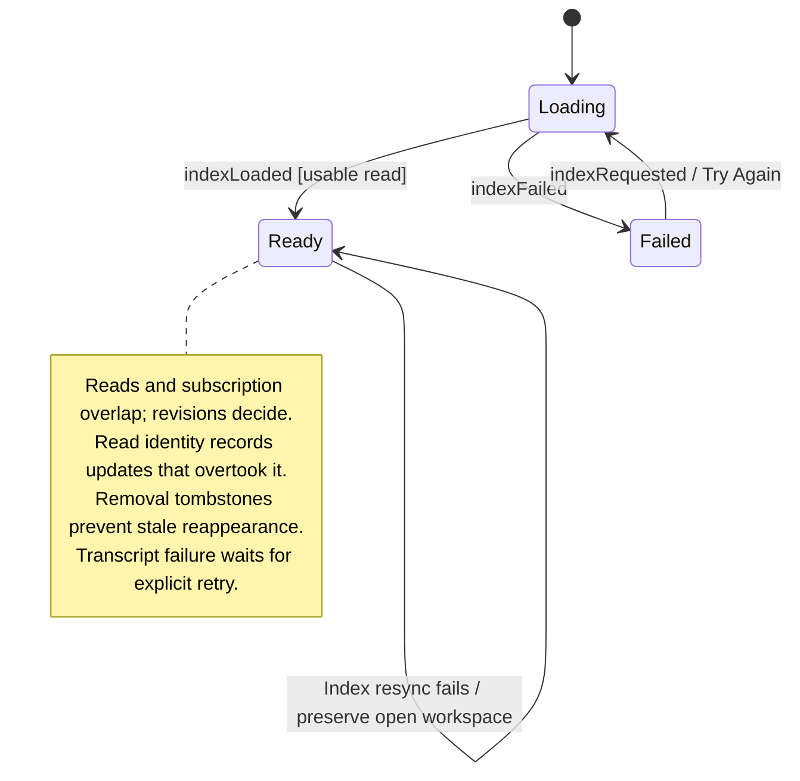

# load, browse, and resynchronize the workspace

The desktop loads a workspace source and uses it to show sessions and summaries. Refreshing replaces those summaries while preserving valid local selections.

When the source removes a visible session, its pane closes. The last pane
shows a new draft if a current channel permits one; otherwise it clears.

The selected [connection mode](README.md#connection-modes) supplies gateway data, a seeded workspace, or an in-memory sample. Some preferences persist, but the complete arrangement of panes does not. Losing a local view is different from deleting a server conversation.

## Further reading

[Source](../../../../../src/desktop/workspace/application/ports.ts) · [Related source](../../../../../src/desktop/dependencies.ts) · [Related tests](../../../../../src/desktop/workspace/application/usecases/updates.test.ts)

## Bounded rule model

One session and three source revisions explore streamed/read summaries, remembered removal and later reappearance. A stale read cannot resurrect removal. Index read outrunning, bounded transcript retention, local optimistic sends and connection modes remain separate owner contracts, not claims made by this small model. The model checks design safety, not the implementation. It asserts no liveness and abstracts transport timing into nondeterministic completion order. Regression sources are evidence of intended behavior; this documentation change does not claim their execution.

## Model coverage

Disposition: direct model. The bounded rule model section names the modeled owner slice and finite abstraction.

Excluded: All exclusions stated in the owning Bounded rule model section remain outside verification.

Source review scope: owner entry points and relevant regression declarations were inventoried against frozen source `77a6b620af4d94b234294f6d273fd74b3dfb44c7`. Existing source checkpoints are retained where this was a partial review. A model result establishes bounded design safety only. Browser appearance and interaction were not checked.
