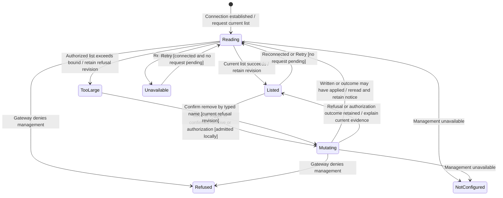
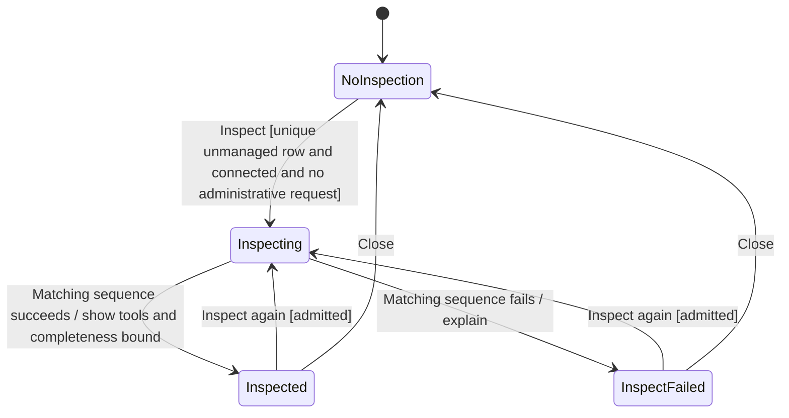

# Manage MCP integrations

Settings → Connections → Integrations manages the gateway's stored MCP server configuration. Add, edit, enable, remove, remote authorization and inspection are separate actions from opening an MCP App inside a conversation. A sample window without a gateway shows a pending entry rather than pretending to save configuration.

The desktop reducer owns the current administrative request, correlated by sequence number. The gateway owns configuration validity and authorization. The chart follows that request and its list evidence; an edit form, consent link and inspection can coexist with it.

## Admission and forms

A successful list supplies management access and the revision a later write must name. Local write admission requires that evidence, a connected transport and no pending administrative request. The gateway still decides who may manage and whether a proposed configuration is valid. A false local guard leaves the request unsent.

Add and Edit retain a draft; Save additionally requires the form's published bounds and kept-value requirements to be satisfied. Managed rows cannot be edited or toggled. Duplicate names form a read-only group because the gateway targets by name; removal confirms the first matching stored row. An oversized list exposes removal by a typed name at the refusal's revision, rather than inventing a partial list. Stored secret values are not listed: keeping one is an explicit null value in the save contract, with launch-change restrictions enforced by the form model and gateway.

## Write outcomes and recovery

Save, toggle and confirmed removal capture the listed revision and a request sequence. Only an answer matching the pending sequence applies. A successful write is followed by a new list; its `live` flag separately reports whether new conversations receive the written configuration. Stored configuration is not proof that an existing provider session adopted it.

Known invalid fields retain the form and explain the refusal. For save and removal, revision conflicts, missing rows and outcomes that may have changed storage trigger a reread. Audit/storage failures retain their applied-versus-unconfirmed distinction; an unconfirmed form does not claim nothing was written. Busy, stopping and reserved-name refusals restore controls without claiming success. Remote authorization can return a consent URL instead of completion; the person completes consent and refreshes. A successful Revoke reports settled versus incomplete authorization cleanup and rereads. A failed remote authorization/revoke retains the list and its failure notice; Retry can refresh that evidence. A diagnostic does not manufacture a completed authorization or physical shutdown.

## Inspection and retirement

Inspection has its own slot because it may take time and does not write configuration. Starting one requires a unique unmanaged server, management access, connectivity, no pending administrative request and no running inspection. Configuration writes can subsequently coexist with the inspection; current list evidence is used to reconcile whether its named server is still stored. An inspection result describes tools and advertised UI metadata, not permission to run a tool.

A running inspection cannot be dismissed through Close in this reducer. Its sequence rejects obsolete results; missing-server failure can request another list. The view has no cancellation port for admitted gateway work. Closing the Settings view does not prove temporary server work stopped or a saved change was undone. Focus returns to an available opener or Add when forms, confirmation or finished inspection close, as owned by the rendered tab.

## Evidence and execution limits

[Reducer cases](../../../../../src/desktop/settings/model/mcp-servers.test.ts) cover administrative ordering, revisions, kept values, duplicate names and outcomes. [Gateway tests](../../../../../src/desktop/settings/adapters/mcp-servers-gateway.test.ts) cover typed translation; [rendered-tab tests](../../../../../src/desktop/settings/ui/integrations-tab.test.tsx) cover controls and focus. This documents implemented behavior; it does not add a new settings regression suite or establish live remote-consent/native-process behavior. The gateway-backed MCP Apps pass exercises a different journey and is not management E2E evidence.
