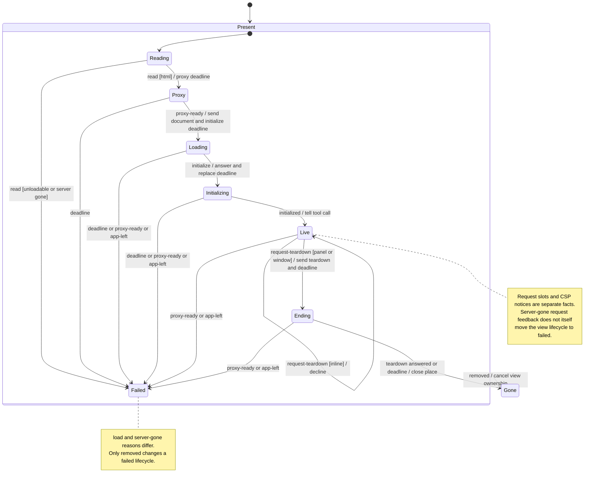
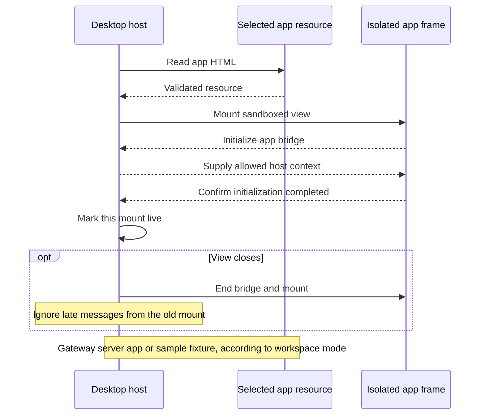

# MCP App view lifecycle

An MCP App is an interactive view supplied by a tool. Nessa reads its HTML, loads it in an isolated frame, and waits for the app to initialize before showing it as live.

Closing the view ends its bridge and ignores late replies. Moving or reopening must use the correct mount identity. Gateway-backed workspaces read app resources and call tools through their workspace client. Sample workspaces use a fixture app. The frame handshake does not grant permission to call every tool.

## Opening the view

## Further reading

[Source](../../../../../src/desktop/widgets/app/model/lifecycle.ts) · [Related source](../../../../../src/desktop/widgets/app/application/bridge.ts)

## Bounded rule model

This owner covers the initialization prerequisite, terminal mount release and inline teardown refusal. Failure abstracts unloadable resources, deadline and unexpected proxy/navigation events. Request concurrency, CSP and gateway authorization remain separate contracts; release is an abstract ownership fact, not physical erasure. The model checks design safety, not the implementation. It asserts no liveness and abstracts transport timing into nondeterministic completion order. Regression sources are evidence of intended behavior; this documentation change does not claim their execution.

## Model coverage

Disposition: direct model. The bounded rule model section names the modeled owner slice and finite abstraction.

Excluded: All exclusions stated in the owning Bounded rule model section remain outside verification.

Source review scope: owner entry points and relevant regression declarations were inventoried against frozen source `77a6b620af4d94b234294f6d273fd74b3dfb44c7`. Existing source checkpoints are retained where this was a partial review. A model result establishes bounded design safety only. Browser appearance and interaction were not checked.
