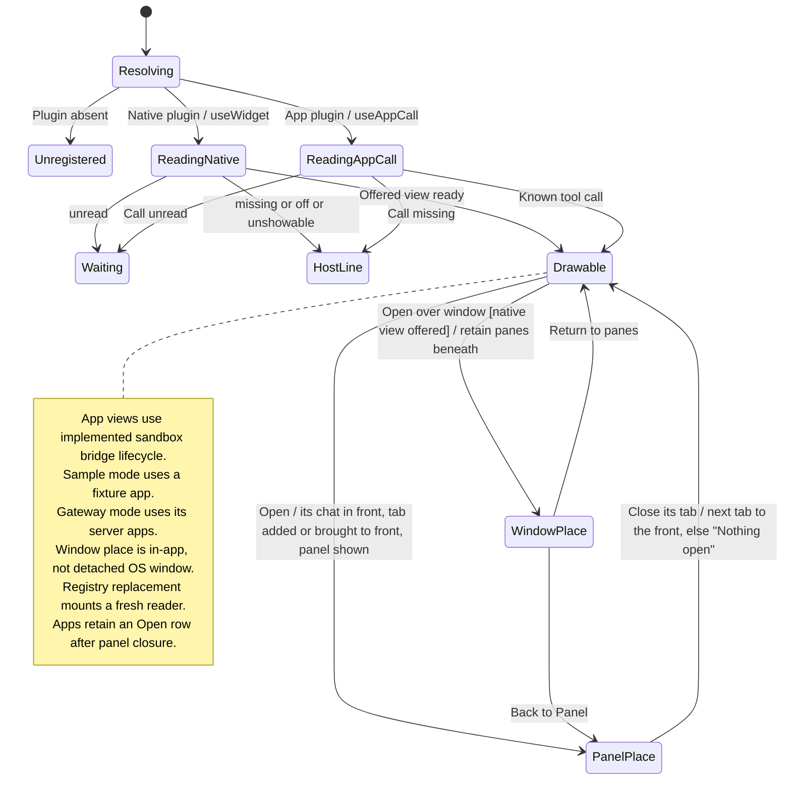

# open a widget inline, in the panel, or over the window

A widget can appear inside a message, as a tab in its chat's right panel, or over the desktop window. Opening it chooses one of these places while retaining the conversation it came from. Each chat has its own panel; opening a widget there brings its chat to the front first (its pane focused, or shown in the focused pane) and shows the panel. A widget open already comes to the front where it is. Chats themselves have no tabs, and a widget never takes a pane.

Native widgets and MCP Apps use different content sources. Gateway mode uses server-provided apps; sample mode uses a fixture. See [connection modes](README.md#connection-modes). A view over the window is still inside Nessa, not a separate operating-system window.

Apps have one live view (#1220): opening a panel retires the inline app and
leaves an Open row in its message. Closing the panel retains that row; Open
starts a fresh panel mount. Only an offered native widget can use the window
place. The [display-mode handoff](../../../../../docs/adr/done/344-mcp-ui.md)
separates the original caller's posted reply from the replacement panel's own
request and reply.

## Further reading

[Source](../../../../../src/desktop/widgets/application/registry.ts) · [Related source](../../../../../src/desktop/widgets/ui/plugin.ts) · [Related tests](../../../../../src/desktop/widgets/application/registry.test.ts)

## Model coverage

Disposition: shared owner model. The app mount and per-chat panel own the modeled view lifetime. [desktop-mcp-app-view](mcp-app-view-lifecycle.md) [desktop-workspace-open-resize-expand-and-restore-the-right-panel](open-resize-expand-and-restore-the-right-panel.md)

Excluded: Plugin host-table projection, escape-stack priority and non-app widget availability are pure contracts; window navigation and mount migration remain unmodeled.

The #1327 placement clarification reviews only that excluded host-table
projection and its browser checks. It does not refresh the broader workspace
or the linked models' source mapping. Historical checkpoints and model results
are retained; TLC was not rerun for this prose and guard clarification.

Source review scope: owner entry points and relevant regression declarations were inventoried against frozen source `77a6b620af4d94b234294f6d273fd74b3dfb44c7`. Existing source checkpoints are retained where this was a partial review. A model result establishes bounded design safety only. Browser appearance and interaction were not checked.

Source review checkpoint: `75b51293a6575662dd4fe68b8e3c0f57862d640a`. The bridge,
lifecycle, registry, host table and chat-panel owners were traced after current
main reconciliation. Original reply posting, replacement-panel replies and
retained Open ownership remain distinct. Historical model receipts keep their
original scope and exclusions; no model mapping or checker result is refreshed.
Browser and native execution receipts retain their own source cuts.
