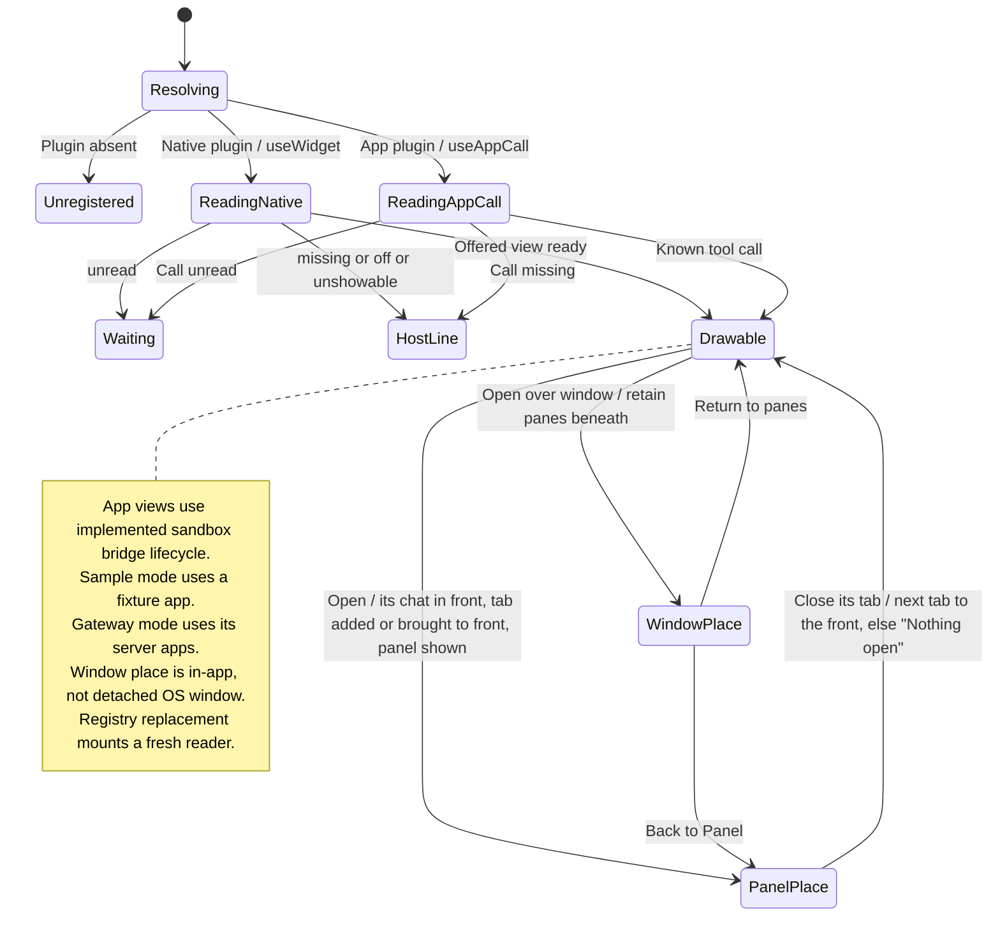

# open a widget inline, in the panel, or over the window

A widget can appear inside a message, as a tab in its chat's right panel, or over the desktop window. Opening it chooses one of these places while retaining the conversation it came from. Each chat has its own panel; opening a widget there brings its chat to the front first (its pane focused, or shown in the focused pane) and shows the panel. A widget open already comes to the front where it is. Conversation documents have separate tabs in the window toolbar; a widget never takes a pane.

Native widgets and MCP Apps use different content sources. Gateway mode uses server-provided apps; sample mode uses a fixture. See [connection modes](README.md#connection-modes). A view over the window is still inside Nessa, not a separate operating-system window.

## Further reading

[Source](../../../../../src/desktop/widgets/application/registry.ts) · [Related source](../../../../../src/desktop/widgets/ui/plugin.ts) · [Related tests](../../../../../src/desktop/widgets/application/registry.test.ts)
