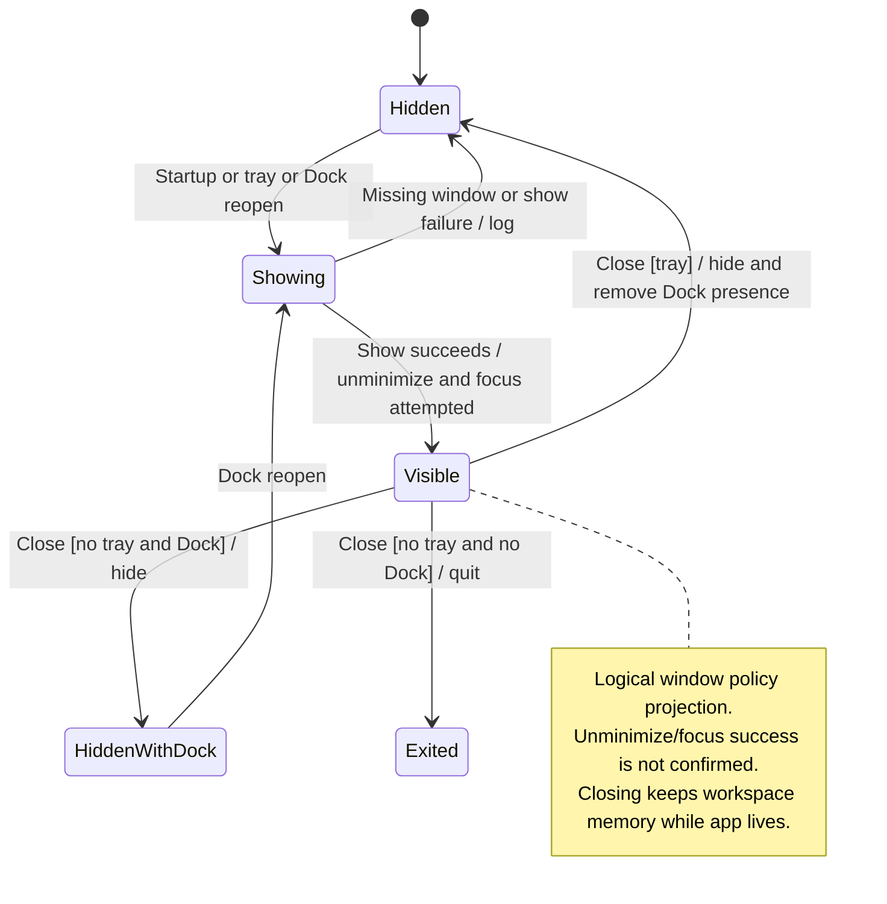

# open, dismiss, and reopen the desktop window

Opening the desktop shows its native window and restores its local workspace view. Dismissing hides that surface according to the native window policy.

Tray and Dock actions can bring it back. Window visibility does not say whether agent work stopped or whether a conversation was deleted.

## Further reading

[Source](../../../../../src-tauri/src/desktop_window.rs) · [Related source](../../../../../src-tauri/src/main.rs)

## Model coverage

Disposition: direct model. The bounded rule model section names this owner, its guarded transitions and the finite design checked. Pure value parsing and geometry stay with the linked source contracts. No claim is made that a checked design is an implementation proof.

The source owner and regression intent were traced at `77a6b620af4d94b234294f6d273fd74b3dfb44c7`; older page checkpoints are retained where the wider journey was only partially re-reviewed. No browser or application-test execution is claimed.

## Bounded rule model

The native desktop_window owner sets Dock presence before show/focus. A failed show can leave Dock presence enabled. Dismiss removes Dock presence only after hide succeeded; a failed hide does not pretend the window disappeared. Without tray or Dock reopen capability close requests Quit. Each native command is serialized at its synchronous owner boundary; this is command ordering, not an OS visibility guarantee, and failed focus/unminimize remain tolerated effects. The model checks design safety, not the implementation. It asserts no liveness and abstracts transport timing into nondeterministic completion order. Regression sources are evidence of intended behavior; this documentation change does not claim their execution.
