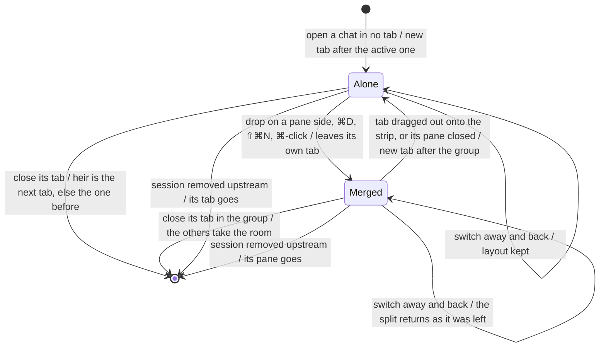

# open, merge, unmerge, switch, and close window tabs

Each window tab is one chat, or a merged group of chats shown side by side,
and it owns its own pane layout. The active tab's layout is the workspace's
`panes`, which every pane command already changes; every other tab keeps its
own. One owner per layout: a pane change in the active tab is reconciled
against the tabs (`reconcileTabs`, run by `withPanes`).

The chart follows one chat's place among the tabs. Tabs are not remembered
between launches.

## Ordering

| What happens | Active tab | Other tabs | Drafts |
| --- | --- | --- | --- |
| A chat in no tab is opened | a new tab, after the active one, becomes active | kept as they were | kept |
| A chat that has a tab is opened | that tab becomes active, its pane focused | kept | kept |
| A row walked with the arrow keys | shown in this tab's focused pane; the one before is let go unless typed in | kept | an untyped draft walked past is let go |
| A pane's layout gains a chat | — | the chat leaves the tab that held it (merge) | kept |
| A pane's layout loses a chat, not closed | — | the chat stands as its own tab after this one (unmerge) | kept |
| A closed widget or an untouched new session leaves a layout | — | it does not come back as a tab | an untouched draft is let go |
| A tab is switched | the arriving tab's layout becomes `panes`, drawn as a cut | the leaving tab keeps `panes` as its own | kept while their tab is open, even hidden |
| The last tab's last chat is closed | a new session's home | — | the home's draft |

## Further reading

[Source](../../../../../src/desktop/workspace/model/window-tabs.ts) · [Related source](../../../../../src/desktop/workspace/application/usecases/panes.ts) · [Related tests](../../../../../src/desktop/workspace/application/usecases/session-tabs.test.ts)
