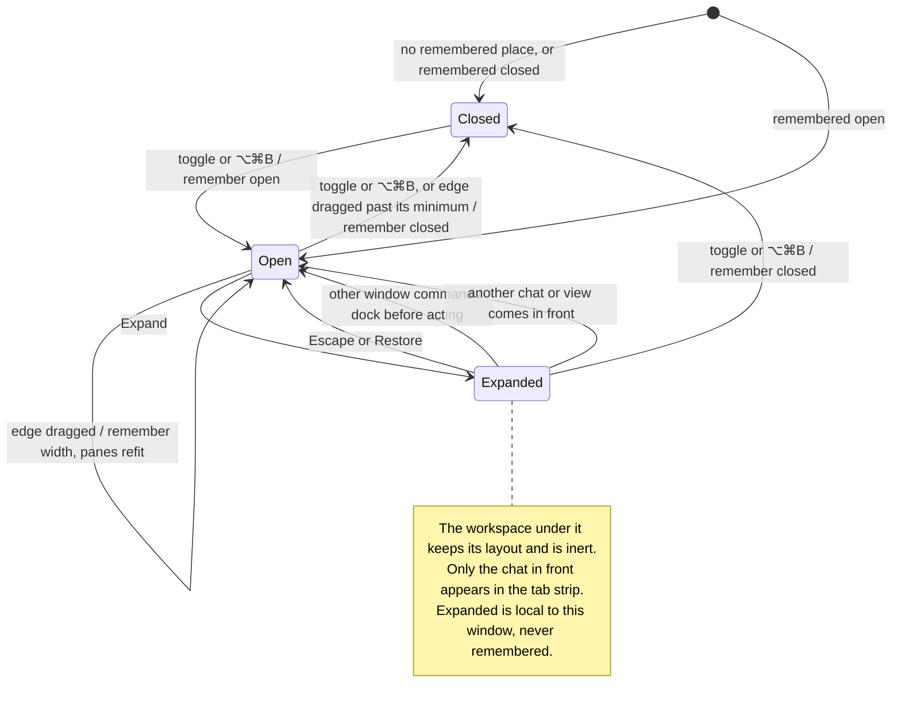

# open, resize, expand and restore the right panel

The right panel is a column beside the panes, in both workspace layouts. Its
toggle at the titlebar's end, or ⌥⌘B, shows and hides it; its edge resizes
it, and dragging that edge far enough right folds it. Whether it is open and
its width are remembered between launches; the panes and side columns fit
the room left beside it.

Expanding it covers the workspace for the chat in front. The workspace stays
laid out and inert beneath, while the tab strip shows only that chat's tab.
New Tab docks the panel and opens the new session in sight. A window command
docks it before acting; bringing another chat, widget or overview in
front docks it too. Escape or Restore brings the columns back as they were.
An Escape a dialog, menu or list takes first is theirs, and under Settings
the window's Escape is Settings'. Expanded is not remembered. A side rail
item's full view hides the panel.

## Source review scope

The recorded source checkpoint integrates the chat-owned panel, tab strip and
window-command behavior. The layout tests and targeted browser controls cover
expansion, New Tab, docking, Escape and restoration. This review does not claim
native material or performance qualification.

## Further reading

[Source](../../../../../src/desktop/workspace/ui/chrome/right-panel.tsx) · [Related source](../../../../../src/desktop/model/right-panel.ts) · [Related tests](../../../../../src/desktop/workspace/ui/layouts/layouts.test.tsx)
