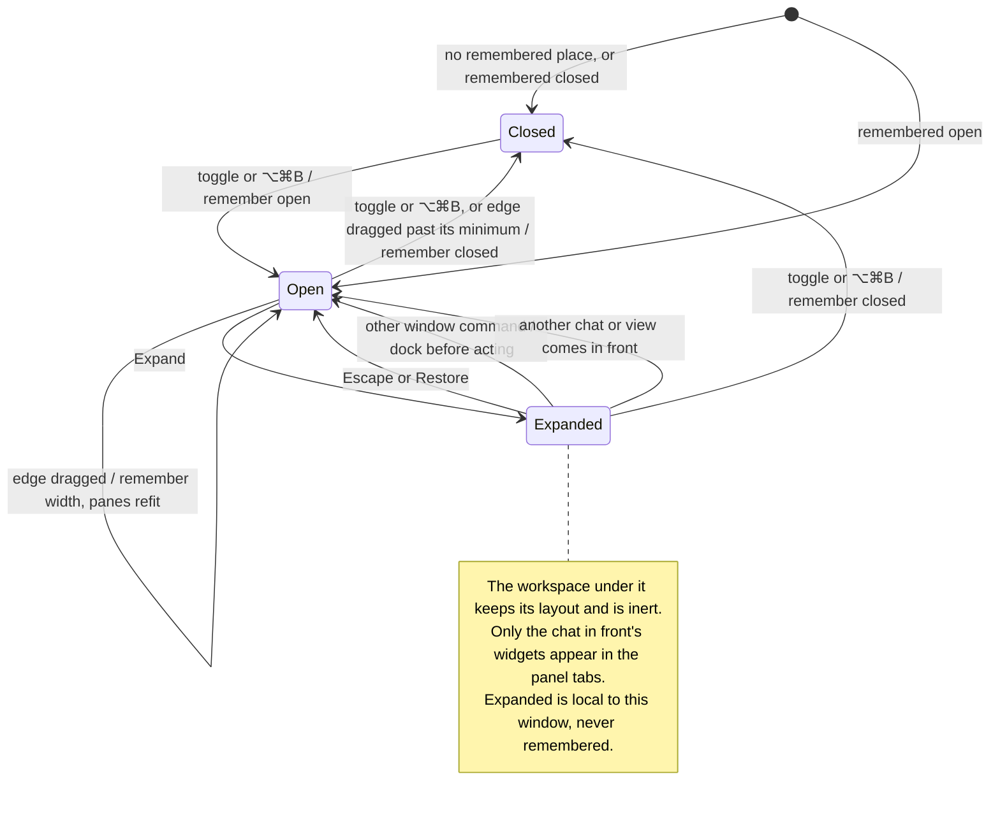

# open, resize, expand and restore the right panel

The right panel is a column beside the panes, in both workspace layouts. Its
toggle at the titlebar's end, or ⌥⌘B, shows and hides it; its edge resizes
it, and dragging that edge far enough right folds it. Whether it is open and
its width are remembered between launches; the panes and side columns fit
the room left beside it.

Each chat has its own panel contents: widgets open as tabs inside the panel,
or a note says that nothing is open. Conversation documents have separate tabs
in the window toolbar; a widget never replaces a chat pane. Changing a panel
tab keeps the same chat in front.

Expanding the panel covers the workspace for that chat. The workspace stays
laid out and inert beneath, while the panel keeps its own tabs or empty note.
⌘N docks the panel and opens the new session in sight. A window command docks
it before acting; bringing another chat or pane, the overview, or a widget
over the window in front docks it too. Escape or Restore brings the columns
back as they were. An Escape a dialog, menu or list takes first is theirs,
and under Settings the window's Escape is Settings'. Expanded is not
remembered. A side rail item's full view hides the panel.

## Source review scope

This review covers the combined window document tabs and each chat's widget
tabs in the right panel. The owning layout and widget tests and browser checks
cover expansion, new sessions, docking, Escape and restoration. Test execution
is reported separately; this page does not claim native material or
performance qualification.

## Further reading

[Source](../../../../../src/desktop/workspace/ui/chrome/right-panel.tsx) · [Related source](../../../../../src/desktop/model/right-panel.ts) · [Related tests](../../../../../src/desktop/workspace/ui/layouts/layouts.test.tsx)
