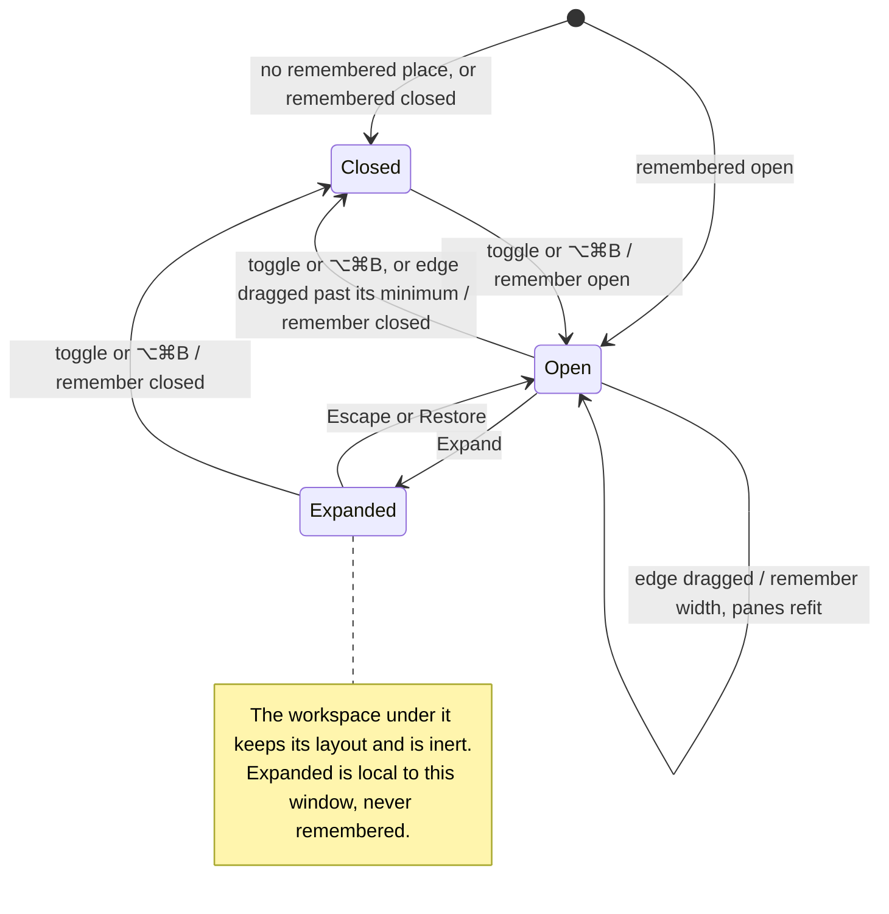

# open, resize, expand and restore the right panel

The right panel is a column beside the panes, in both workspace layouts. Its
toggle at the titlebar's end, or ⌥⌘B, shows and hides it; its edge resizes
it, and dragging that edge far enough right folds it. Whether it is open and
its width are remembered between launches; the panes and side columns fit
the room left beside it.

Expanding it covers the workspace, which stays laid out and inert beneath;
Escape or Restore brings the columns back as they were. Expanded is not
remembered. A side rail item's full view hides the panel.

## Further reading

[Source](../../../../../src/desktop/workspace/ui/chrome/right-panel.tsx) · [Related source](../../../../../src/desktop/model/right-panel.ts) · [Related tests](../../../../../src/desktop/workspace/ui/layouts/layouts.test.tsx)
