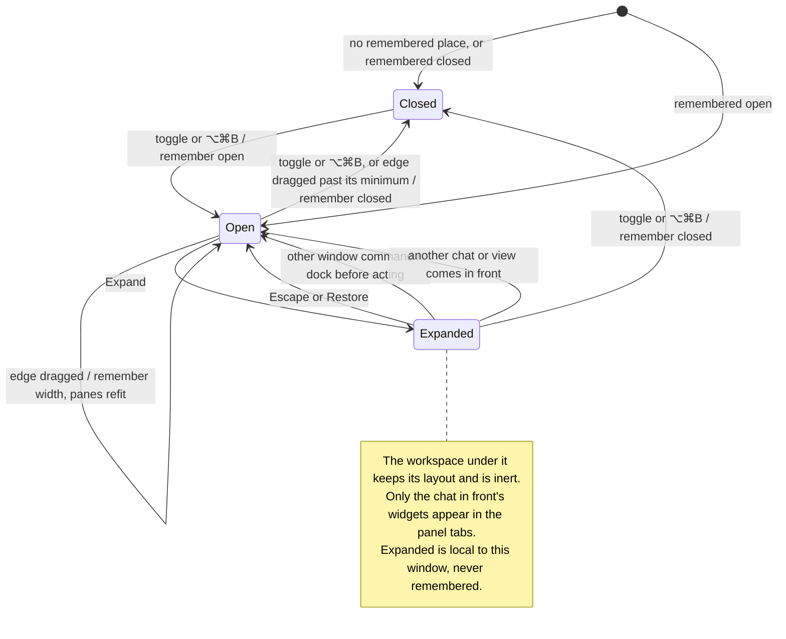

# open, resize, expand and restore the right panel

The right panel is a column beside the panes, in both workspace layouts. Its
toggle at the titlebar's end, or ⌥⌘B, shows and hides it; its edge resizes
it, and dragging that edge far enough right folds it. Whether it is open and
its width are remembered between launches; the panes and side columns fit
the room left beside it.

Each chat has its own panel contents: widgets open as tabs inside the panel,
or a note says that nothing is open. Chats themselves have no tabs, and a
widget never replaces a chat pane. Changing a panel tab keeps the same chat
in front.

Expanding the panel covers the workspace for that chat. The workspace stays
laid out and inert beneath, while the panel keeps its own tabs or empty note.
⌘N docks the panel and opens the new session in sight. A window command docks
it before acting; bringing another chat or pane, the overview, or a widget
over the window in front docks it too. Escape or Restore brings the columns
back as they were. An Escape a dialog, menu or list takes first is theirs,
and under Settings the window's Escape is Settings'. Expanded is not
remembered. A side rail item's full view hides the panel.

## Source review scope

The recorded source checkpoint preserves the incoming per-chat widget tabs and
window-command behavior alongside the paired-reader integration. The owning
layout and widget tests and maintained browser checks cover expansion, new
sessions, docking, Escape and restoration. Test execution is reported separately;
this page does not claim native material or performance qualification.

## Further reading

[Source](../../../../../src/desktop/workspace/ui/chrome/right-panel.tsx) · [Related source](../../../../../src/desktop/model/right-panel.ts) · [Related tests](../../../../../src/desktop/workspace/ui/layouts/layouts.test.tsx)

## Bounded rule model

Two chats and two MCP App widgets check per-chat tab ownership and replacement of the previous app tab. Switching chat restores only its own widget selection. Multiple other-plugin tabs, close-neighbor order, resize/maximize geometry, keyboard focus and app bridge teardown are separate contracts; the app mount owner models teardown. The model checks design safety, not the implementation. It asserts no liveness and abstracts transport timing into nondeterministic completion order. Regression sources are evidence of intended behavior; this documentation change does not claim their execution.

## Model coverage

Disposition: direct model. The bounded rule model section names the modeled owner slice and finite abstraction.

Excluded: All exclusions stated in the owning Bounded rule model section remain outside verification.

Source review scope: owner entry points and relevant regression declarations were inventoried against frozen source `77a6b620af4d94b234294f6d273fd74b3dfb44c7`. Existing source checkpoints are retained where this was a partial review. A model result establishes bounded design safety only. Browser appearance and interaction were not checked.
