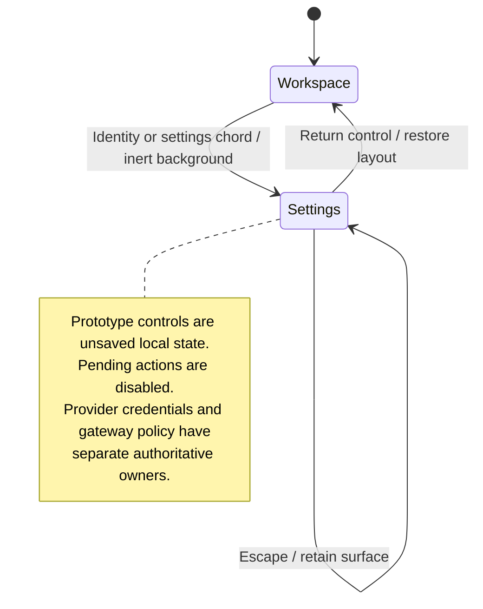

# open, search, and change desktop settings

Settings opens inside the desktop. Search helps find a preference, and changing a working control updates its local setting.

Some catalogue entries are prototypes or unavailable controls. Their presence does not mean they save a provider credential or change an agent. Escape follows the settings view's return behavior.

## Further reading

[Source](../../../../../src/desktop/ui/desktop-window.tsx) · [Related source](../../../../../src/desktop/settings/ui/settings-view.tsx) · [Related tests](../../../../../src/desktop/settings/ui/settings-view.test.tsx)

## Pending settings actions

[Native-hook saves and notification permission requests](settings-action-owners.md)
have their own synchronous admission and source/view lifetime owners. Disabled
controls alone do not establish request coalescing or safe late settlement.

## Model coverage

Disposition: shared owner model. Window appearance and preference persistence use the shared stored-preference owner. Catalogue grouping and ranking are pure contracts, and async gateway-backed settings rows retain their own owning model pages. See [desktop-window-preferences](window-preferences.md).

Settings and switcher UI appearance were not browser-checked. These models check bounded owner decisions and do not execute React or native platform effects.

Async settings owners: [native hooks and notices](settings-action-owners.md), [MCP integrations](manage-mcp-integrations.md), [linked devices](linked-devices.md), [permission revocation](permission-rule-revocation.md), [GitHub reads](../../gateway/github-reads.md), [encrypted vault](../../gateway/local-vault.md), [channel workspaces](../../gateway/channel-workspaces.md). Provider setup/runtime download and key saving follow the [host setup owner](../../host/startup/save-provider-credentials-and-download-a-runtime.md). Opening settings is not evidence that an unsupported row performs an effect.
