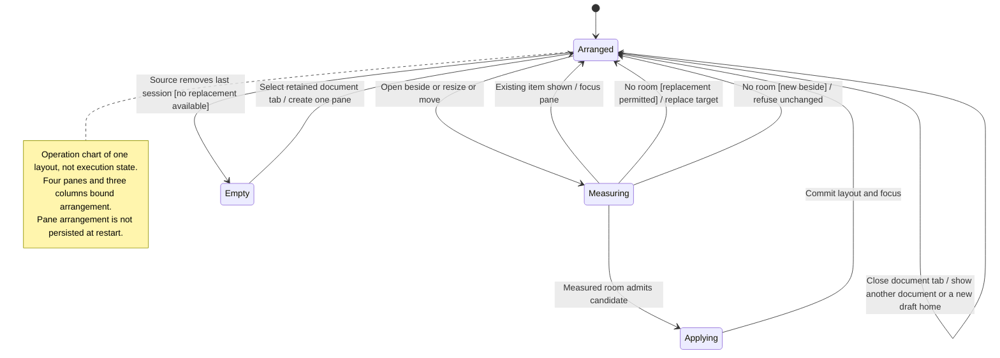

# open, split, resize, and close panes

Opening beside a pane first looks for space on the right, then below. When there is no room, it replaces the current content where that action allows replacement.

Splitting and resizing respect the available workspace. A new draft that must open beside another pane is refused when there is no room. Closing a pane removes its view, not its conversation.

Open conversation documents have tabs in the window toolbar. Selecting a
document already in a pane focuses that pane. Selecting a hidden document
replaces the focused pane's content without changing its neighboring panes or
their sizes. If no pane remains, selecting a retained tab creates one.

Closing one of several panes keeps its document tab, including a typed draft,
so the person can reopen it. Closing the document tab releases its draft and
its right-panel contents. A visible tab's pane shows another open document or
a new draft home when one is available. Source removal may leave no valid
home; the last pane then clears instead of pointing at a removed session.

A corner pane's header text and controls keep clear of the window controls
while a side column reopens and the pane flies to its new position. The
header returns to its normal inset after landing. Its background picture
can still extend behind the window controls.

The pane root clips overflowing content; its transcript owns scrolling. Focusing
a descendant does not scroll the root or move its header out of the titlebar.
`columns.mjs --only pane-clipping` checks this with an overflowing focus fixture
in both browser engines and layouts.

## Further reading

[Source](../../../../../src/desktop/workspace/application/usecases/panes.ts) · [Related source](../../../../../src/desktop/workspace/adapters/store/commands.ts) · [Related tests](../../../../../src/desktop/workspace/application/usecases/panes.test.ts)
