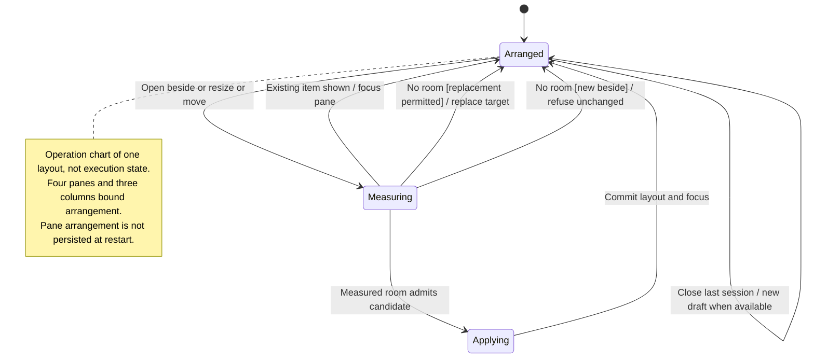

# open, split, resize, and close panes

Opening beside a pane first looks for space on the right, then below. When there is no room, it replaces the current content where that action allows replacement.

Splitting and resizing respect the available workspace. A new draft that must open beside another pane is refused when there is no room. Closing a pane removes its view, not its conversation.

Opening a chat no pane shows takes the focused pane's place, as a browser's
address bar does. A new session's draft it replaces is let go unless something
is typed in it; that one is kept, and the next new session asked for in its
channel shows it again. Closing a pane lets go of its draft, typed in or not.
Chats have no tabs: only widgets open as tabs, in the chat's right panel.

A corner pane's header text and controls keep clear of the window controls
while a side column reopens and the pane flies to its new position. The
header returns to its normal inset after landing. Its background picture
can still extend behind the window controls.

## Further reading

[Source](../../../../../src/desktop/workspace/application/usecases/panes.ts) · [Related source](../../../../../src/desktop/workspace/adapters/store/commands.ts) · [Related tests](../../../../../src/desktop/workspace/application/usecases/panes.test.ts)
