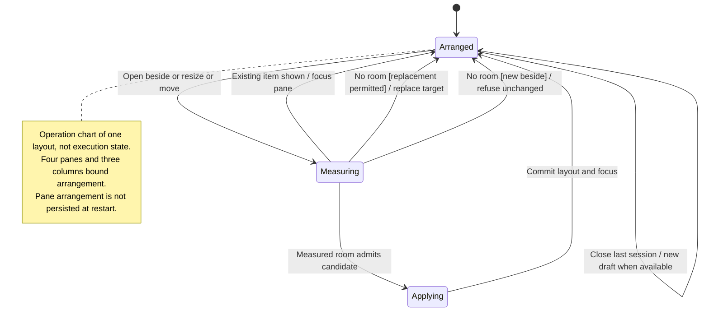

# open, split, resize, and close panes

Opening beside a pane first looks for space on the right, then below. When there is no room, it replaces the current content where that action allows replacement.

Splitting and resizing respect the available workspace. A new draft that must open beside another pane is refused when there is no room. Closing a pane removes its view, not its conversation.

Opening a chat no pane shows takes the focused pane's place, as a browser's
address bar does. A new session's draft it replaces is let go unless something
is typed in it; that one is kept, and the next new session asked for in its
channel shows it again. Closing a pane lets go of its draft, typed in or not.
Chats have no tabs: only widgets open as tabs, in the chat's right panel.

A corner pane's header text and controls keep clear of the window controls
while a side column reopens and the pane flies to its new position. The
header returns to its normal inset after landing. Its background picture
can still extend behind the window controls.

The pane root clips overflowing content; its transcript owns scrolling. Focusing
a descendant does not scroll the root or move its header out of the titlebar.
`columns.mjs --only pane-clipping` checks this with an overflowing focus fixture
in both browser engines and layouts; the conversation stress `window` step also
measures root offsets and header geometry after its long preceding sequence.

The split-motion and unsent-reply browser fixtures reclaim side-column room
before opening a second pane. In columns layout they hide the session list;
split admission can then fold the sidebar to fit the new pane. This reaches
an admitted, readable layout even in a narrow window. Removal fixtures reveal the session rows before using
their actions. This setup does not change the refusal when a real split has
insufficient room, or the requirement to retain the closing pane's content
until its box leaves.

## Further reading

[Source](../../../../../src/desktop/workspace/application/usecases/panes.ts) · [Related source](../../../../../src/desktop/workspace/adapters/store/commands.ts) · [Related tests](../../../../../src/desktop/workspace/application/usecases/panes.test.ts)
