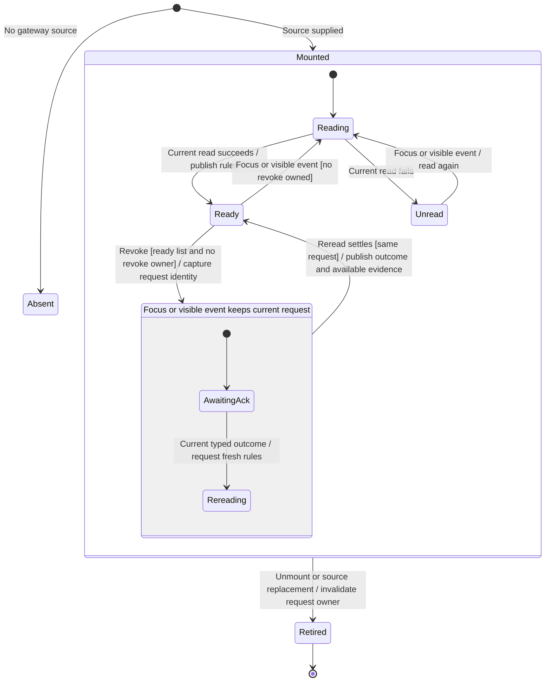

# Revoke a remembered permission rule

Settings → Privacy & Permissions → Access lists remembered tool rules for a workspace. Revoke removes a selected rule through the gateway. While that operation is pending, the row controls remain disabled through both its acknowledgement and the list read that follows.

This chart follows the mounted desktop component's request owner. It controls frontend dispatch and presentation. Server authorization, durable rule mutation and any agent work already admitted remain separate owners.

## Read ownership and repeated inputs

The component owns an identified Read or Revoke request. A later background read replaces an earlier read, and an earlier reply cannot overwrite it. Starting a revoke replaces the read owner, so a read already in flight cannot clear the pending action when it returns.

A synchronous admission check on this request owner coalesces repeated Revoke callbacks before React has rendered the disabled button. Disabled controls display the owned operation; their rendered state is not the sole dispatch guard. The same pending owner protects every rule button until settlement.

## Revoke owns its acknowledgement and reread

A focus or visible event while the current owner is Revoke starts no competing read. It does not enqueue another check for replay. The revoke's required post-command reread supplies the current evidence instead. Keeping one owner through both awaits prevents an unrelated read from enabling another mutation or discarding the original command outcome.

This is the correction for the audit counterexample: focus returned a ready list while the first revoke was pending, enabling a second frontend dispatch with a different request ID. The reproduction does not establish duplicate physical backend effects. [PR1–PR5](../../../../design/user-flow-ordering.md#permission-rule-revoke-versus-background-reads) records the ordering contract.

## What the result proves

A failed or unconfirmed revoke is followed by a read. If the read still lists the rule, the view says it is still remembered. If the read omits it, the view says it is no longer listed. If the read fails, the view says the list could not be read again. The diagnostic alone does not select any of those facts.

A successful applied acknowledgement with an unavailable reread can remove that known revoked rule from the retained list, without claiming the rest of the list is current. The existing adapter translates transport failures into typed outcomes. An operation that never settles retains its local owner; this component has no separate timeout or physical termination guarantee.

## Retirement and physical effects

Unmount or source replacement invalidates the request identity. A late revoke outcome cannot publish into the replacement or initiate an obsolete follow-up read. A reread already started before retirement can still finish but cannot publish afterward.

Retiring the component does not cancel an admitted gateway revoke. There is no cancellation port here. A new source owns its new list and controls independently; the chart's final marker does not mean the old server operation was undone.

## Evidence

[Component regressions](../../../../../src/desktop/settings/ui/permission-rule-rows.test.tsx) cover focus and visibility refresh, post-command read ownership, an earlier background read, source replacement, unmount and repeated same-task clicks. Existing cases retain the distinct acknowledgement/reread combinations above.

The Chromium [ordering fixture](../../../../../verification/desktop/evidence/user-flow-ordering/README.md) mounts the production component. The baseline permits a second frontend dispatch after focus; the fixed owner retains one pending dispatch and enables recovery after settlement. WebKit and real gateway integration remain separate, unrun gates in this environment.
