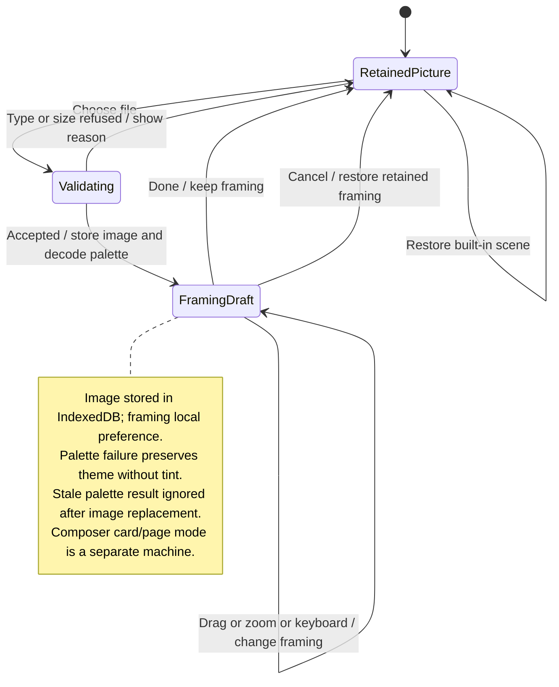

# personalize the home header and composer

You can choose a home image, adjust its focal position and change local composer appearance. Cancelling an edit restores the previous choice.

Images are stored locally in the browser's database and are limited to 25 MB. Animated images play for the focused pane. These preferences do not change agent configuration or server history.

## Further reading

[Source](../../../../../src/desktop/ui/header-art.tsx) · [Related source](../../../../../src/desktop/ui/header-picture.tsx) · [Related tests](../../../../../src/desktop/model/header-image.test.ts)

## Model coverage

Disposition: direct model. The bounded rule model section names this owner, its guarded transitions and the finite design checked. Pure value parsing and geometry stay with the linked source contracts. No claim is made that a checked design is an implementation proof.

The source owner and regression intent were traced at `77a6b620af4d94b234294f6d273fd74b3dfb44c7`; older page checkpoints are retained where the wider journey was only partially re-reviewed. No browser or application-test execution is claimed.

## Bounded rule model

Two picture choices model first storage read versus a later local choice, independently completing IndexedDB writes and stale decode/palette completion. A clear is represented by another chosen version whose payload is the built-in scene; identity matters, not the blob bytes. Memory retains the latest local choice and decode results publish only for their current picture. Persistence may finish out of order or fail: the adapter has no write-version fence, so this model intentionally does not promise that a later reload sees the most recent choice. Object-URL revocation and GIF still-frame guards use the same held-picture identity. Exact palette math, image bounds and framing geometry remain pure contracts; retained framing changes only on Done, while Cancel drops the draft. Composer page hysteresis uses 7-line open and 3-line close thresholds from page-mode.ts. The model checks design safety, not the implementation. It asserts no liveness and abstracts transport timing into nondeterministic completion order. Regression sources are evidence of intended behavior; this documentation change does not claim their execution.
