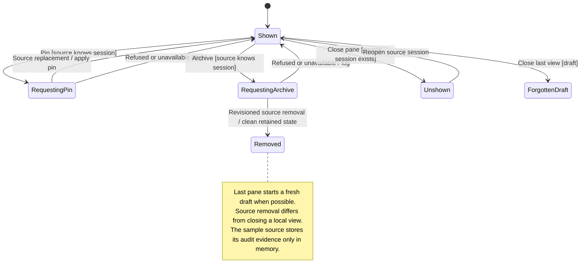

# pin, archive, or close a workspace session view

Pinning and archiving use the current workspace source. The view updates from that source's answer, rather than assuming the action succeeded.

Closing a pane removes its view. It does not delete a remote session. A local draft can be forgotten when nothing still holds it. In [sample mode](README.md#connection-modes), these actions remain fixture behavior. Gateway mode delegates remote actions to its workspace source.

## Further reading

[Source](../../../../../src/desktop/workspace/ui/session-actions.tsx) · [Related source](../../../../../src/desktop/workspace/adapters/store/commands.ts) · [Related tests](../../../../../src/desktop/workspace/model/session-lifecycle.test.ts)

## Model coverage

Disposition: shared owner model. Source removals and local pane identity have separate owning models. [desktop-workspace-load-browse-and-resynchronize-the-workspace](load-browse-and-resynchronize-the-workspace.md) [desktop-workspace-open-split-resize-and-close-panes](open-split-resize-and-close-panes.md)

Excluded: Pin persistence, archive authorization, last-pane draft fallback and fixture audit behavior are not checked.

Source review scope: owner entry points and relevant regression declarations were inventoried against frozen source `77a6b620af4d94b234294f6d273fd74b3dfb44c7`. Existing source checkpoints are retained where this was a partial review. A model result establishes bounded design safety only. Browser appearance and interaction were not checked.
