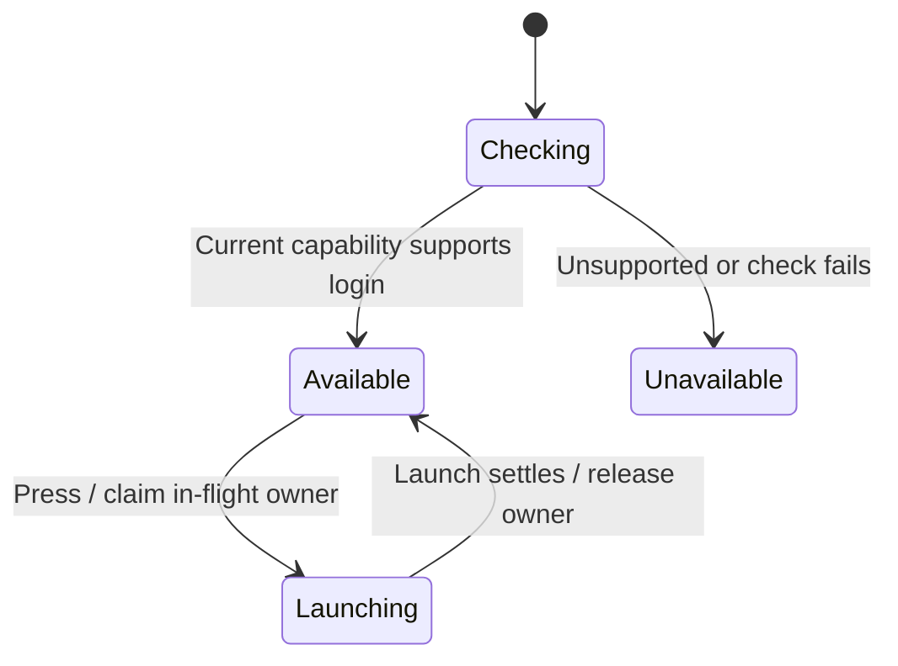

# Recover provider sign-in

Claude and Codex can offer a sign-in card. Other providers retain their normal refusal. The refusal must still identify the latest published input, and no local submission may have observed that same input since. This causality check uses input identity, not elapsed time.

The card checks host capability and binds the answer to both check and action callbacks. Unsupported or failed capability checks disable launch. A synchronous in-flight owner prevents repeated launch before the disabled render. Launch failure allows retry and says why. Launch success does not establish authenticated provider state, replay the input, or dismiss the refusal. The external login flow is outside this source tree.

## Bounded rule model

Two input identities cover recovery eligibility and a newer local submission. Launch preserves refusal evidence. Capability callbacks, launch-slot serialization and the external login protocol are excluded from this model. The model checks design safety, not the implementation. It asserts no liveness and abstracts transport timing into nondeterministic completion order. Regression sources are evidence of intended behavior; this documentation change does not claim their execution.

## Model coverage

Disposition: direct model. The bounded rule model section names the modeled owner slice and finite abstraction.

Excluded: All exclusions stated in the owning Bounded rule model section remain outside verification.

Source review scope: owner entry points and relevant regression declarations were inventoried against frozen source `77a6b620af4d94b234294f6d273fd74b3dfb44c7`. Existing source checkpoints are retained where this was a partial review. A model result establishes bounded design safety only. Browser appearance and interaction were not checked.
