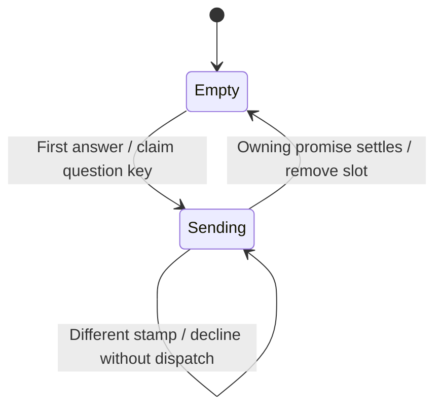

# Join an answer already being sent

A question may appear in the overview and underlying pane at once. Both use one record composed for that workspace store. The first answer owns a promise. A matching answer and initiator joins it; a different answer gets a distinct refusal without dispatch. Settlement removes that exact promise so refusal can be retried. Stores do not share records.

## Bounded rule model

One question key and two answer/initiator stamps cover matching joins, conflicting refusal, success/failure settlement and retry. Dispatch is counted across at most two flights. Gateway question validity, authorization and answer persistence are separate owners. The model checks design safety, not the implementation. It asserts no liveness and abstracts transport timing into nondeterministic completion order. Regression sources are evidence of intended behavior; this documentation change does not claim their execution.

## Model coverage

Disposition: direct model. The bounded rule model section names the modeled owner slice and finite abstraction.

Excluded: All exclusions stated in the owning Bounded rule model section remain outside verification.

Source review scope: owner entry points and relevant regression declarations were inventoried against frozen source `77a6b620af4d94b234294f6d273fd74b3dfb44c7`. Existing source checkpoints are retained where this was a partial review. A model result establishes bounded design safety only. Browser appearance and interaction were not checked.
