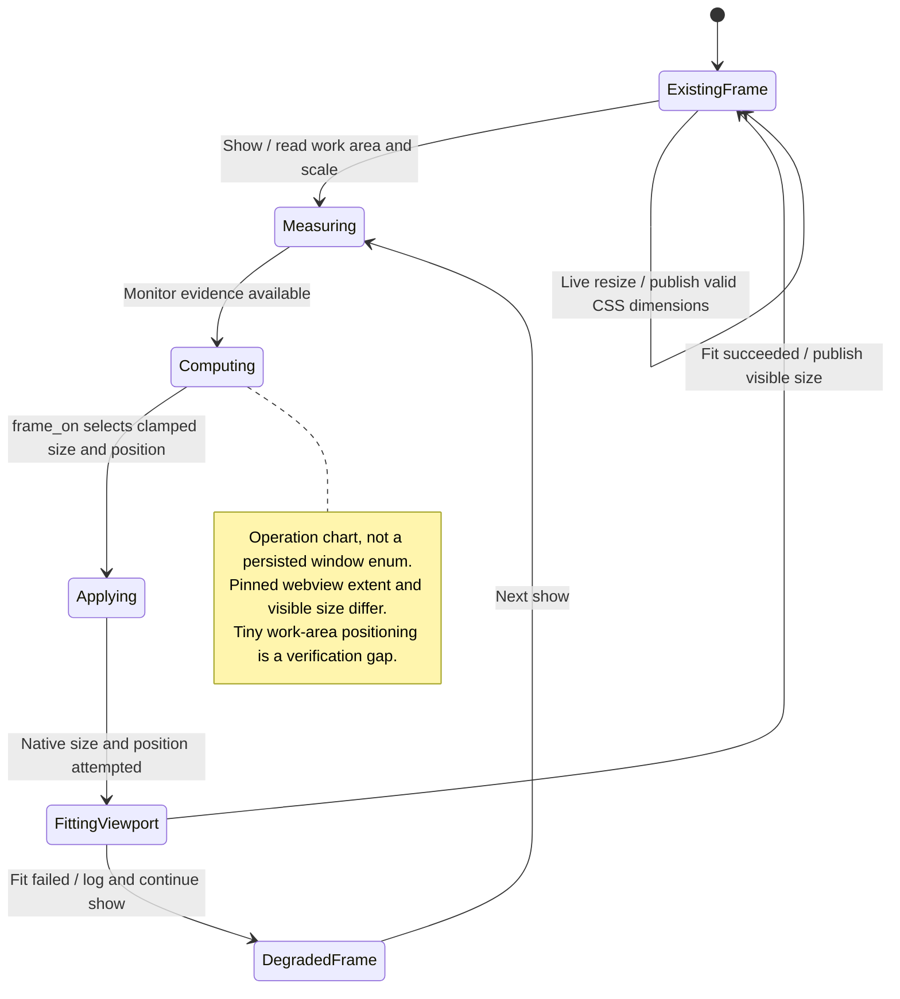

# resize and refit the panel across displays

The floating panel remembers its size and fits within the current display's usable area. Moving across displays can change the space available to it.

Each show checks the work area again. Resizing preserves the panel's native placement rules instead of letting a stale size put it beyond the screen.

## Further reading

[Source](../../../../../src-tauri/src/panel.rs) · [Related source](../../../../../src-tauri/src/platform/macos/viewport.rs) · [Related tests](../../../../../src/panel/adapters/panel-frame.test.ts)

## Model coverage

Disposition: direct model. The bounded rule model section names this owner, its guarded transitions and the finite design checked. Pure value parsing and geometry stay with the linked source contracts. No claim is made that a checked design is an implementation proof.

The source owner and regression intent were traced at `77a6b620af4d94b234294f6d273fd74b3dfb44c7`; older page checkpoints are retained where the wider journey was only partially re-reviewed. No browser or application-test execution is claimed.

## Bounded rule model

The panel-frame owner receives both an initial async size read and resize events, publishes only finite positive dimensions, and ignores late reads after unmount. Initial read may arrive after a newer resize: the source has no revision fence, so this model permits that overwrite. Native macOS fit pins the stage to the bottom-right and uses max(window, work-area) dimensions; that pure geometry differs from the lifetime modeled here. Physical display/compositor behavior remains an OS boundary rather than an invented freshness guarantee. The model checks design safety, not the implementation. It asserts no liveness and abstracts transport timing into nondeterministic completion order. Regression sources are evidence of intended behavior; this documentation change does not claim their execution.
