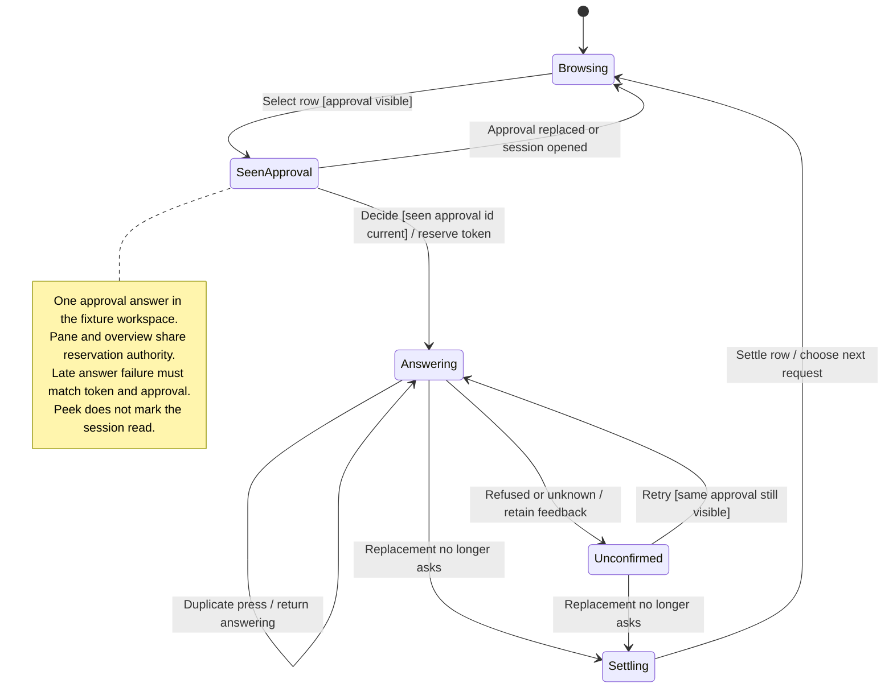

# review agents, answer requests, and reply from the overview

The overview groups sessions that need your attention, are running, or have finished. Opening one takes you to its conversation or waiting request.

Answers and replies use the selected workspace source. In [sample mode](README.md#connection-modes), these cards do not prove that live subagents were started or that a provider received an approval.

## Further reading

[Source](../../../../../src/desktop/workspace/ui/overview/overview.tsx) · [Related source](../../../../../src/desktop/workspace/ui/overview/session-peek.tsx) · [Related tests](../../../../../src/desktop/workspace/ui/overview/overview.test.tsx)

## Model coverage

Disposition: shared owner model. Question-flight identity and SDK review ownership are shared decisions. [desktop-question-flights](question-answer-flights.md) [sdk-reviews](../../sdk/reviews.md)

Excluded: Overview filter retention, animation, reply outbox and card focus are not modeled.

Source review scope: owner entry points and relevant regression declarations were inventoried against frozen source `77a6b620af4d94b234294f6d273fd74b3dfb44c7`. Existing source checkpoints are retained where this was a partial review. A model result establishes bounded design safety only. Browser appearance and interaction were not checked.
