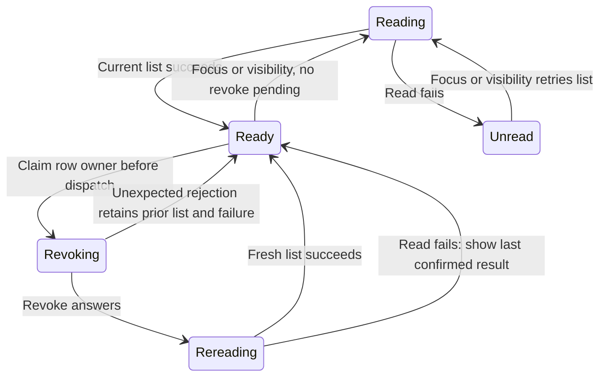

# Revoke remembered app access

Open Settings → Privacy & Permissions → Access and revoke the app remembered by **Always allow this app**. Trust is gateway-wide by MCP server, so the next app message requires approval again. This is separate from a tool permission rule scoped to a project, from removing an MCP server, and from cancelling an already admitted app action.

The list and revoke product methods require `credential.manage`; a paired device's ordinary session lacks that grant. The server name is the trust identity. An empty name is refused. A gateway with no MCP apps reports no trusted servers, and revoking absent trust is an unchanged result.

## What a reply and a list mean

The UI synchronously claims a busy owner before dispatch. Focus refresh cannot overtake that revoke. It then rereads after the typed result: a successful fresh list becomes current evidence even if the revoke response was uncertain. If reread fails but revoke succeeded, it removes the named app from the retained list. If both fail, it retains the old list and reports failure. This retained list is not a fresh claim that every entry is still trusted.

Unmount or source replacement invalidates the view’s current request version. A late answer cannot update the replacement view. In this app-specific implementation, a completed revoke can still initiate its follow-up read before the later settlement guard rejects publication; it is not the same no-obsolete-reread contract as [permission-rule revocation](permission-rule-revocation.md). Neither UI retirement nor loss of a reply is cancellation of a committed trust change.

## Persistence and audit have separate outcomes

The application records the requested revoke before changing trust. The trust adapter serializes its set, publishes the private trusted-apps.json file and updates memory only after successful publication. An unreadable trust file at startup yields no remembered trust, so messages ask again. The application then records applied/unchanged evidence with the caller and server identity.

An applied audit failure returns an error after trust has already changed. The product method maps this to temporarily unavailable. Reread the list rather than treating that error as rollback. Retrying removal is safe for the desired absence, but each invocation creates its own audit operation: the API does not provide an exactly-once durable receipt keyed by the supplied request ID. A successful current list also does not repair an earlier audit-write failure.

## Implementation evidence

[Product tests](../../../../../crates/nessa-server/tests/product/trusted_apps.rs) cover request validation. [Settings audit tests](../../../../../crates/nessa-conversation/tests/conversation/settings_audit.rs) retain server identity and reject contradictory rewrites. [App-message tests](../../../../../crates/nessa-conversation/tests/conversation/app_messages.rs) exercise remembered trust and removal. [Access rows](../../../../../src/desktop/settings/ui/permission-rule-rows.test.tsx) cover app listing, revoke ownership and stale reads. No new proof is attributed to the existing permission-rule model.

## Verification scope

This task guide was source-reviewed at `31d023ed3e4cd60053f771d44137f6af1e1b92ca`. It has no TLA model: the existing device-polling, permission-rule and Boat-allocation models do not verify this new feature. Regression links identify relevant implementation tests; execution results and independent review are recorded in [the refresh evidence](../../../feature-refresh-1268.md). No full application, real cloud or cross-platform qualification is claimed.
