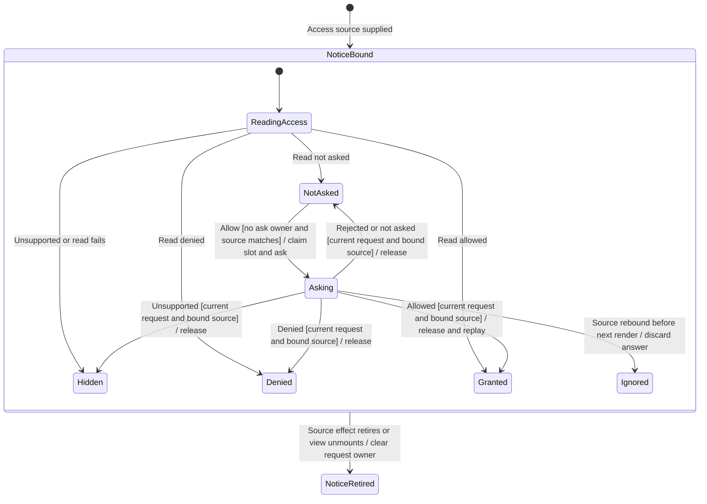

# Finish or retire a settings action

A native-hook switch saves a choice for the next Claude or Codex process start.
Allow requests permission to show waiting-review notifications. Each action
admits one pending request immediately, then disables its controls. When its
source or view retires, its late answers cannot change the replacement view.

These are independent owners and can run concurrently. The gateway still
authorizes native writes; the host/browser decides notification permission.
Neither action approves a tool request. Leaving Settings does not undo an
admitted physical effect.

## Save a native-hook choice

This chart follows one mounted gateway source. A replacement gets a new owner;
it does not resume the retired save. Without a source, rows say the choice is
unavailable. Initial and focus reads supply stored configuration.

```mermaid
stateDiagram-v2
    [*] --> NativeBound: Gateway source supplied
    state NativeBound {
        [*] --> Reading
        Reading --> Ready: Current read succeeds
        Reading --> Unread: Current read fails
        Ready --> Reading: Focus or visible [no save owner]
        Unread --> Reading: Focus or visible [no save owner]
        Ready --> SaveOwned: Toggle [no save owner] / claim slot and dispatch
        state SaveOwned {
            [*] --> AwaitingWrite
            AwaitingWrite --> Rereading: Current write answers / read actual choice
        }
        SaveOwned --> Ready: Reread succeeds [current owner] / show stored choice
        SaveOwned --> Ready: Reread fails [current owner and matching ACK] / show acknowledged choice
        SaveOwned --> Unread: Reread fails [current owner and no matching ACK]
    }
    NativeBound --> NativeRetired: Source changes or view unmounts / retire slot and listeners
```

### Native save admission

The save installs an object identity before calling the gateway. Both switches
then show disabled. Another callback, including one before React commits that
render, sees the save owner and declines to dispatch. Focus/visibility reads
defer while it holds the write and mandatory reread. Earlier reads cannot
publish over it. The request receives a fresh ID.

Showing the proposed boolean means work was sent; it proves neither storage nor
a running harness change. The existing adapter translates read/write exceptions
into typed failed outcomes.

### Acknowledgement and stored truth

The write owner checks it is still current before starting its read and after
that read, then releases the slot. A successful read supplies actual choices
even after a lost/refused write; failure copy preserves that uncertainty. If the
read fails, a successful answer for the requested agent supplies its acknowledged
choice. A mismatched or failed answer cannot do so; the rows become unread.
Focus can retry a later read.

This preserves next-process-start semantics, missing-agent copy and stored-choice
recovery. It does not restart a process or erase external hooks.

### Native source retirement

Cleanup retires request identity and removes focus/visibility listeners. The
replacement can read immediately while the old save remains unresolved. An old
save cannot start another read; an already-started old reread cannot publish,
release the replacement's owner or change its switches. No port cancels the
admitted gateway save.

## Ask for notification permission

This chart follows the row's bound access source and current request. Initial
reading does not ask permission. Waiting-review snapshots and system
notifications have separate lifetimes.

### Allow admission and recovery

Allow claims an ask identity before invoking the browser/host source. Its view
disables Allow until settlement and declines repeated callbacks. Admission does
not depend on a later disabled render.

A rejected promise becomes not asked, releases the owner and enables retry.
Not-asked results do the same. Denied access shows the bound source's system or
browser instructions; unsupported access hides the rows. This component does
not watch changes made in external settings continuously. A later mount/source
change reads again.

### Current grants replay waiting reviews

A grant updates the row and invokes waiting-review replay only when the request
identity and currently bound access source still match. Replay uses the latest
snapshot, including reviews received before the grant. No binding means there
is nothing to replay. The notifier owns notice identity and avoids showing a
notice it already holds. OS delivery and selecting a notice are separate from
this callback and do not answer a tool review.

### Retiring an outstanding prompt

Unmount or source-effect cleanup clears request identity. Old completion cannot
publish into a replacement, release its pending prompt or invoke its replay.
A source rebound even before the next render also fails the current-source
check. The discarded answer leaves the old row pending until the next source
render starts its own read; no reactive subscription to global binding is added.

Cleanup does not cancel a platform prompt or withdraw granted permission.
Replacing only the replay callback, with the same active view/access source,
is not modeled as view retirement. Ordinary production source rebinding remains
unproven by controlled tests.

## Evidence, scope and known gaps

[Native-row tests](../../../../../src/desktop/settings/ui/native-hooks-rows.test.tsx)
and [notice-row tests](../../../../../src/desktop/settings/ui/review-notice-rows.test.tsx)
add 16 regressions and retain 12 existing cases. All 28 pass; original owners
produce nine failures and 19 passes. The four minimal counterexamples alone
produce four failures and 12 passes. The wider settings/notice suite passes
354 tests in 16 files.

The [browser script](../../../../../verification/desktop/scripts/settings-action-owners.mjs)
drives production components with controlled ports. Chromium holds all six
checks; original owners hold two of six. The explicit two-engine run retains
those six checks but reports missing WebKit, exit 2. This is not a two-engine
pass. Same-task native callbacks and deliberate source replacement remain
qualified; two visible OS prompts and notification authorization bypass were
not established.

[Design and invariants](../../../../design/settings-action-owners.md) ·
[Evidence and remaining gates](../../../../../verification/desktop/evidence/settings-action-owners/README.md).
Only these owners/tests were checked at the source checkpoint. This follow-up
does not alter frozen #1090/#1093 branches. When combined with their broader
settings journeys, this page owns corrected pending-action behavior; their older
source checkpoints do not claim these later fixes.
